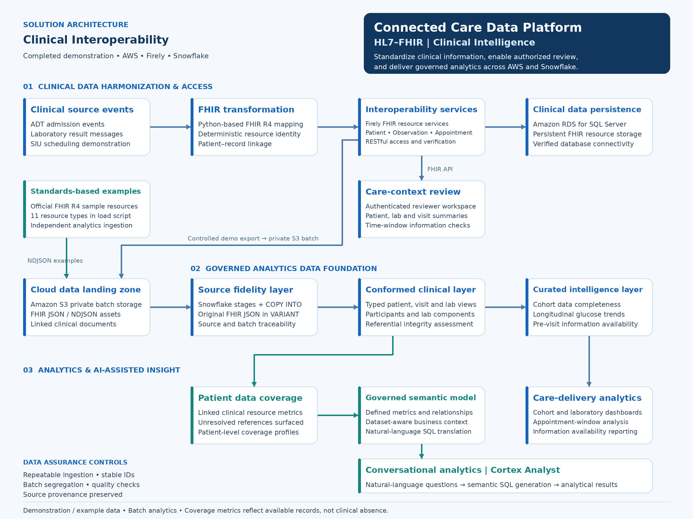
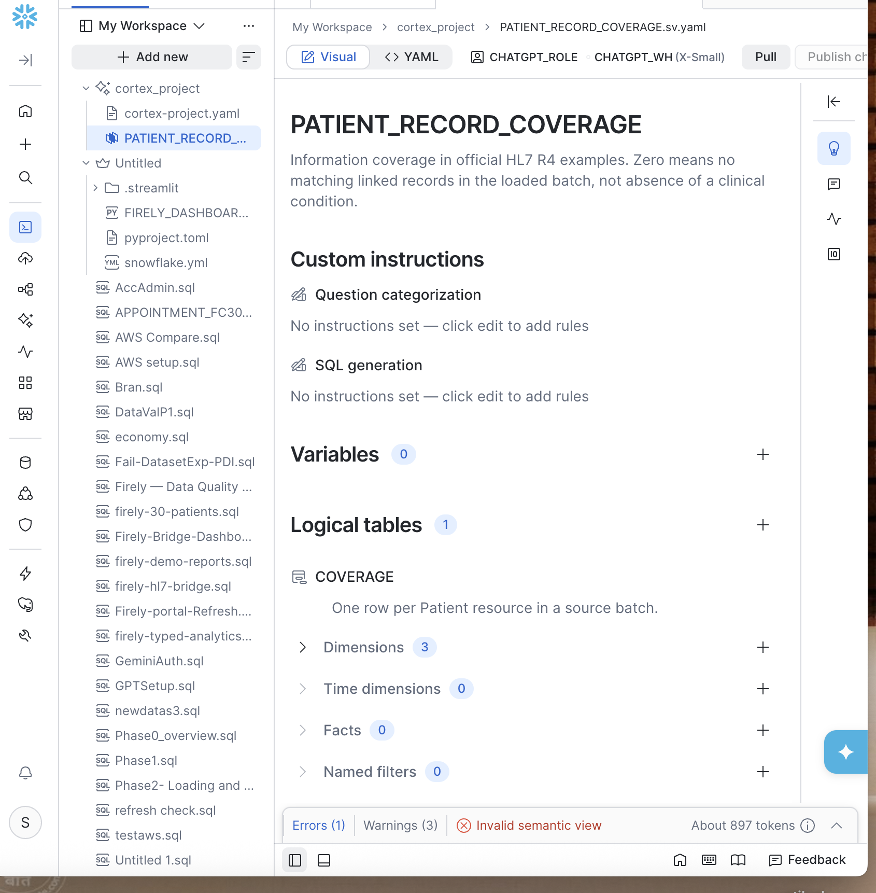
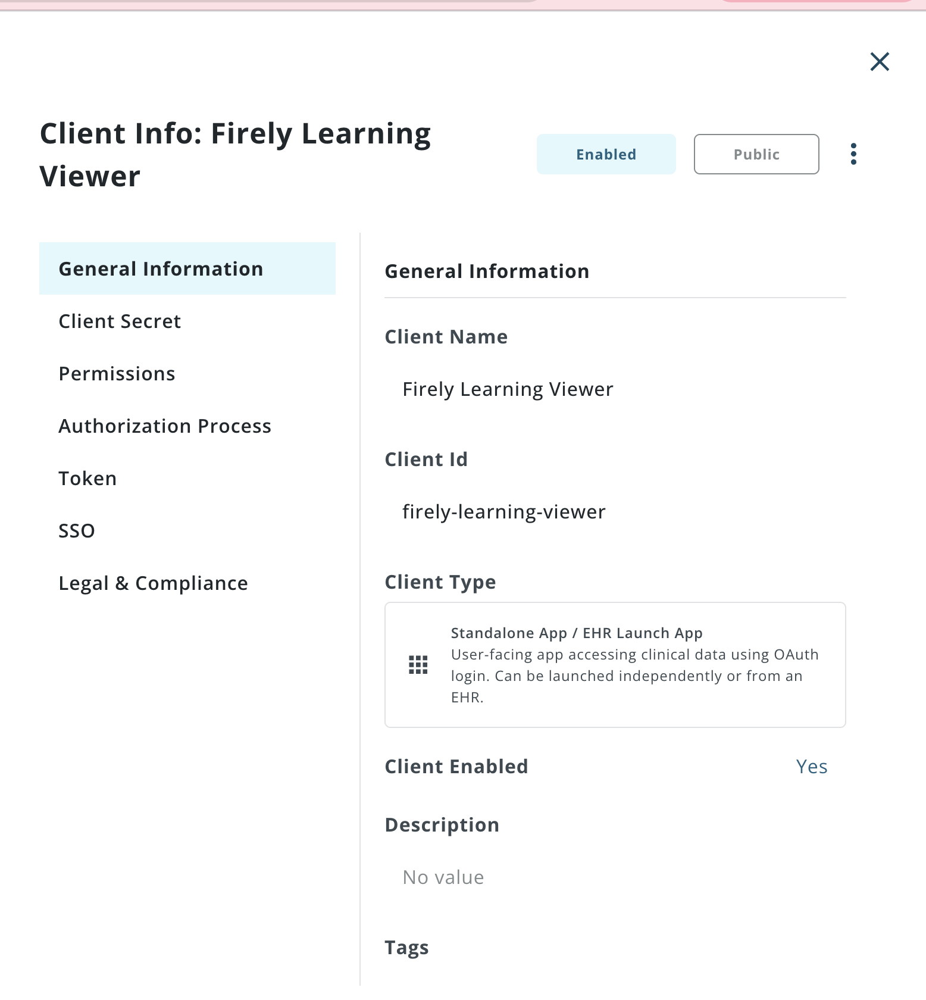
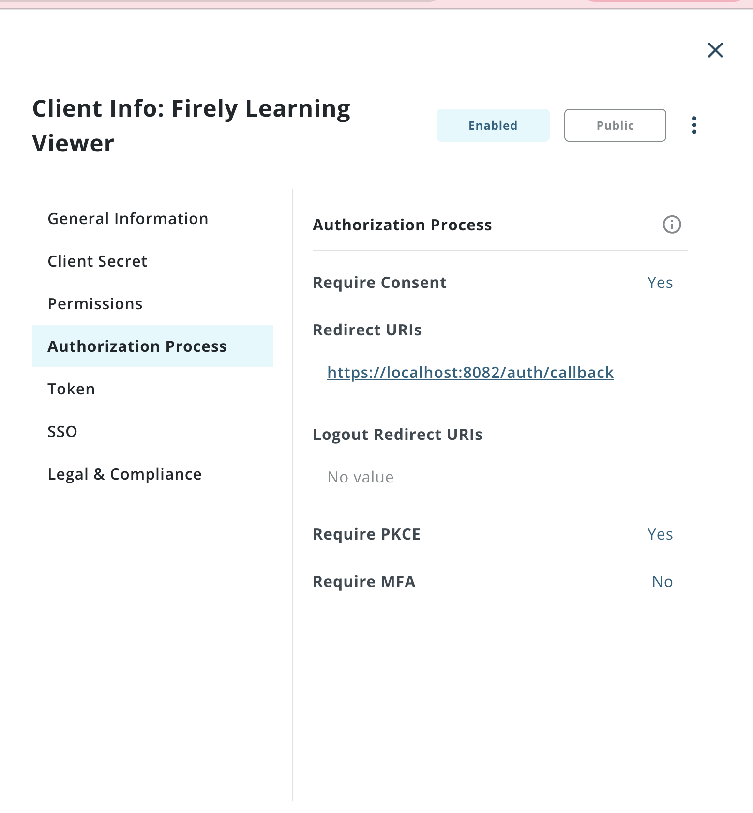

# Connected Care Data Platform

**Making sure the right patient information is on file before every appointment: from HL7 v2 feeds to FHIR, a secure clinical review, and verified analytics in Snowflake.**

[](https://github.com/tarunL2203/hl7-fhir-connected-care/actions/workflows/ci.yml)
[](LICENSE)


## Contents

| **Overview** | **Evidence** | **Use it** | **Background** |
|---|---|---|---|
| [The problem](#the-problem) | [Results](#results) | [Choose your path](#choose-your-path) | [Project timeline](#project-timeline) |
| [What this platform does](#what-this-platform-does) | [One appointment, end to end](#one-appointment-end-to-end) | [Documentation](#documentation) | [Scope and limitations](#scope-and-limitations) |
| [Architecture](#architecture) | [Screenshots](#screenshots) | [Getting started](#getting-started) | [Data, privacy and security](#data-privacy-and-security) |
| [Answers without code](#answers-without-code) |  | [Repository layout](#repository-layout) | [References](#references) · [License](#license-and-acknowledgements) |

**Deep dives:** [Business overview](docs/business-overview.md) · [Walkthrough](docs/walkthrough.md) · [Architecture](docs/architecture.md) · [Cortex Analyst](docs/cortex-analyst.md) · [Cortex Code](docs/cortex-code.md) · [Snowflake design](docs/snowflake-design.md) · [HL7 → FHIR mapping](docs/hl7-to-fhir-mapping.md) · [Decisions](docs/decisions.md) · [Results](results/README.md)

## The problem

In a JAMA study of 32 U.S. primary care clinics, clinicians reported important clinical information missing in **about 1 in 7 visits**, and **lab results were the item missing most often**. Clinicians judged that:
- **59.5%** of those gaps could delay care or lead to additional services;
- **44%** were at least somewhat likely to harm the patient;
- in **36%** of cases they spent five minutes or more searching without finding it.

More than half of the missing information existed, just outside the clinic's own system.<sup>[1](#references)</sup> And today, only **43%** of U.S. acute care hospitals routinely send, receive, find and integrate patient data from outside organizations.<sup>[2](#references)</sup>

So the information often exists. It just hasn't arrived where the visit happens, in a form anyone can trust. Staff also can't tell "the test was never done" from "the result is stuck somewhere": the first needs an order, the second needs a records request or an interface fix.

<sub>[↑ Back to contents](#contents)</sub>

## What this platform does

For a high-frequency case (*is the required lab result on file before the visit?*), the platform runs the whole path end to end:

1. **Converts HL7 v2 feeds** (admissions, lab results, scheduling) into **FHIR R4** resources, with strict validation and replay-safe IDs.
2. **Assesses every booked appointment** against configurable pre-visit rules. The answer is one of four: *complete*, *gap*, *unable to assess* or *no rule*. A gap is never reported unless retrieval was complete.
3. **Routes the right work to the right team.** Genuine gaps go to records staff with a due time; data and interface faults go to the integration team; every resolution is recorded.
4. **Gives clinicians a secure review view**: OIDC + PKCE sign-in, scoped FHIR access, and documents released only after patient and checksum verification.
5. **Delivers analytics-ready data to Snowflake.** RAW and typed layers, reports and a Streamlit dashboard. Loads are **reconciled row by row** against their source and re-checked in CI.
6. **Answers questions in plain English.** Cortex Analyst gives non-technical staff governed answers from a semantic model, and Cortex Code explains, checks and traces the pipeline on request. Both were checked against independent benchmarks.

**Who it serves:** records and front-desk staff (a worklist with owners and due times), clinicians (a trustworthy pre-visit view), integration teams (faults routed to them, not to the front desk), and operations leaders (readiness across visits).

<sub>[↑ Back to contents](#contents)</sub>

## Architecture

Converters turn HL7 v2 feeds into FHIR on Firely Server. A secured Firely server (on Amazon RDS, later a protected local snapshot) feeds the rules engine, the worklist and a reviewer portal with Firely Auth sign-in. Authenticated batch exports land in Amazon S3 and load into Snowflake for reports, the Streamlit dashboard and Cortex. Components, runtime flows and trust boundaries are in [the architecture document](docs/architecture.md).



<sub>[↑ Back to contents](#contents)</sub>

## Answers without code

**Cortex Analyst, Cortex Code and a Streamlit dashboard.** After the architecture, these are the platform's most important features. The people who most need its answers (operations leaders, records staff, quality and audit teams) don't write SQL. Three Snowflake features let them get those answers anyway, and the answers shown here were checked against the project's own benchmarks and definitions.

| Feature | Who it's for | What they do | In this project |
|---|---|---|---|
| **Streamlit dashboard** | Staff who ask the same questions every day | Click, filter, download a CSV | Appointment information status, patient details and a data-quality review queue |
| [**Cortex Analyst**](docs/cortex-analyst.md) | Anyone with a new question | Type it in English; get a table, the tool's reading of the question, and the SQL | Record coverage for 265 patients. Asked whether "zero allergy records" means "no allergies", it explains why the data can't say |
| [**Cortex Code**](docs/cortex-code.md) | Reviewers, auditors, product owners, engineers | Ask how a number is made, or whether to trust it | Re-derived the observation count layer by layer (531 in, 503 resolved, 28 excluded with reasons), exactly matching the benchmark |

| Cortex Analyst: a clinical caveat built into the model | Cortex Code: auditing the pipeline on request |
|---|---|
|  |  |

**Why it matters now.** Language models became far more reliable at SQL once they worked from a semantic layer of agreed definitions, and usable for regulated data once they ran inside the platform's own access controls. Governed self-service answers have become a deciding factor in how organizations choose a data platform. For developers, it means business meaning and clinical caveats are defined once and reused by every front end. The [Cortex Analyst](docs/cortex-analyst.md) and [Cortex Code](docs/cortex-code.md) pages explain who benefits, what developers gain, and where the limits are, including the one time Cortex Code answered for the wrong patient.

<sub>[↑ Back to contents](#contents)</sub>

## Results

| What was verified | Result | Evidence |
|---|---|---|
| Live reviewer security checks | **15 / 15**: 401 anonymous, 403 wrong patient or bad CSRF, replayed session rejected | [reviewer milestone](archive/milestone-reports/2026-10-03-reviewer-milestone.md) |
| Snowflake loads vs the exported source | **7/7, 3/3, 4/4, 5/5** rows match on ID, payload, file and row; **0** duplicates. Re-run in CI on every push | [reproduce](results/README.md#reproduce-the-reconciliation) |
| Repeat loads | **0** rows added (`LOAD_SKIPPED`); typed `MERGE` reruns insert **0** | [query history](results/2026-10-06-typed-analytics/05-merge-query-history.csv) |
| Typed layer vs RAW | **0** review rows, **0** broken patient links, **0** payload mismatches | [validation](results/2026-10-06-typed-analytics/00-typed-validation.csv) |
| 30-patient failure-case catalogue | **30 / 30** outcomes as expected; **6 / 6** broken records flagged for review | [results](results/2026-10-07-30-patient-batch/) |
| Visit-rule edge cases | **9 / 9** window and status tests pass in Snowflake | [rule checks](results/2026-10-06-typed-analytics/04-rule-checks.csv) |
| Reference integrity, 933 official FHIR examples | **609 / 641** clinical resources resolve to a patient, matching the offline benchmark exactly | [link check](results/2026-10-08-fhir-r4-examples/patient-link-check.csv) |
| Cortex Analyst answers vs offline benchmarks | 265 patients, 15 with observations, and the one patient with medication orders but no allergy record: **all match**. A clinical conclusion the data can't support is declined | [Cortex Analyst](docs/cortex-analyst.md#what-it-answered) |
| Cortex Code's independent lineage trace | **531 → 503** observations resolved; 12 + 10 + 6 exclusions explained; 0 duplicates, 0 join fan-out. Matches the link check exactly | [Cortex Code](docs/cortex-code.md#what-it-did-here) |
| Automated checks | **51** tests, 4 load reconciliations, the 30-patient outcome check and 2 reproducibility checks, all in CI | [CI workflow](.github/workflows/ci.yml) |

<sub>[↑ Back to contents](#contents)</sub>

## One appointment, end to end

| Step | What happens | Artifact |
|---|---|---|
| 1. Messages | Two ORU^R01 glucose results (95 and 102 mg/dL) and an SIU^S12 booking arrive | [`samples/`](samples/) |
| 2. FHIR | Converted to two Observations and an Appointment with deterministic IDs; the Appointment is read back from Firely | [mapping spec](docs/hl7-to-fhir-mapping.md) |
| 3. Assessment | Both results fall in the 7-day window, so the visit is **information_complete** | [portal screenshot](docs/images/reviewer-portal-patient-assessment.png) |
| 4. Export | 1 Patient, 2 Observations, 1 Appointment as NDJSON with a SHA-256 manifest | [batch](analytics/batches/hl7-appointment-bridge-20261007T162957465413Z/) |
| 5. Snowflake | Loaded to RAW and reconciled **4/4** against the export | [RAW download](results/2026-10-07-hl7-bridge/raw-download-appointment-bridge.csv) |
| 6. Answer | SQL evaluates the same rule: 2 qualifying results, **information_complete** | [report](results/2026-10-07-hl7-bridge/appointment-information-availability.csv) |
| 7. Update | A third result arrives; re-export reconciles **5/5**, and a repeat load adds nothing | [repeat COPY](results/2026-10-07-portal-refresh/repeat-copy.csv) |

The full story, with the actual messages, JSON and outputs, is in [**the walkthrough**](docs/walkthrough.md).

<sub>[↑ Back to contents](#contents)</sub>

## Screenshots

| Reviewer portal | Readiness dashboard (Streamlit in Snowflake) | Appointment details (Streamlit in Snowflake) |
|---|---|---|
|  |  |  |

| Cortex Analyst | Cortex Code | Semantic view |
|---|---|---|
|  |  |  |

| Firely Auth client (public, no secret) | PKCE required |
|---|---|
|  |  |

<sub>[↑ Back to contents](#contents)</sub>

## Choose your path

| If you are… | Start with |
|---|---|
| A healthcare or business reviewer | [Business overview](docs/business-overview.md): users, rules, scenarios, requirement traceability. Then the [HL7 → FHIR mapping spec](docs/hl7-to-fhir-mapping.md) |
| A data or Snowflake reviewer | [Snowflake design](docs/snowflake-design.md): layers, idempotent loads, validation, semantic model, roadmap. Then the [SQL](analytics/snowflake/) |
| An architect or engineer | [Architecture](docs/architecture.md), [decisions](docs/decisions.md) and [Getting started](#getting-started) |
| Someone who wants answers without writing SQL | [Cortex Analyst](docs/cortex-analyst.md) for questions in plain English, and [Cortex Code](docs/cortex-code.md) for how the numbers are made and whether to trust them |
| New to healthcare data | [Background: HL7 v2 and FHIR](docs/background-hl7-fhir.md) and the [walkthrough](docs/walkthrough.md) |

<sub>[↑ Back to contents](#contents)</sub>

## Documentation

| Document | Contents |
|---|---|
| [Business overview](docs/business-overview.md) | Problem, users, workflow, rules, outcomes, tested scenarios, requirement traceability |
| [Walkthrough](docs/walkthrough.md) | One appointment from HL7 message to Snowflake report, with real artifacts |
| [Architecture](docs/architecture.md) | Components, runtime flows, trust boundaries and controls |
| [Decisions](docs/decisions.md) | Nine architecture decision records |
| [HL7 → FHIR mapping](docs/hl7-to-fhir-mapping.md) | Field-level interface spec for ADT, ORU and SIU |
| [Snowflake design](docs/snowflake-design.md) | Objects, RAW and typed layers, idempotency, proofs, security, cost, roadmap |
| [Cortex Analyst](docs/cortex-analyst.md) | Questions in plain English: who benefits, what developers gain, why it matters now, limits |
| [Cortex Code](docs/cortex-code.md) | An AI engineer inside Snowflake: explaining, auditing and tracing the pipeline, and one lesson learned |
| [Project history](docs/project-history.md) | Phase-by-phase build log and lessons learned |
| [Background](docs/background-hl7-fhir.md) | HL7 v2, FHIR, SMART, LOINC and UCUM for newcomers |
| [HIPAA considerations](docs/hipaa-considerations.md) | Safeguards mapped to the project, and their limits |
| [Requirements document](docs/BRD-FRD-and-Progress.docx) | Original BRD/FRD and delivery plan (Word) |
| [Presentations](docs/presentations/) | Platform deck, consulting edition, analytics demo (PowerPoint) |
| [Results](results/README.md) | The evidence, and how to reproduce the reconciliation |

<sub>[↑ Back to contents](#contents)</sub>

## Getting started

**Requirements:** Python 3.11. The full stack also needs Docker, Firely Server and Firely Auth (evaluation licences from [Firely](https://fire.ly)), the AWS CLI and a Snowflake account.

```sh
python -m venv .venv && source .venv/bin/activate
pip install -r requirements.txt -r requirements-dev.txt
make check PYTHON=python      # lint, 51 tests, reconciliations and reproducibility checks
```

Everything above runs offline, with no servers or cloud accounts. Useful single commands:

```sh
python converters/convert_lab.py samples/lab-002.hl7     # HL7 ORU → FHIR Observation
python converters/appointment_bridge.py --self-test      # SIU^S12 mapping and stable-ID checks
python analytics/compare_fc30_outcomes.py                # 30-patient expected vs actual
make reconcile PYTHON=python                             # re-check every Snowflake load
```

**Full stack** (Firely Server on 8080/8081, Firely Auth on 5001, reviewer portal on 8082):
1. Start from [`.env.example`](.env.example) and the [sanitized Firely Auth configuration](infra/firely-auth/appsettings.instance.example.json).
2. Supply your own licences, TLS certificates (in `auth/certs/`) and signing key.
3. Start the portal with `python worklist/authenticated_viewer_server.py`.

[`worklist/README.md`](worklist/README.md) covers the portal's modules, tests and checks, and the [Snowflake design](docs/snowflake-design.md) covers loading.

<sub>[↑ Back to contents](#contents)</sub>

## Repository layout

```
converters/        HL7 v2 → FHIR R4: admissions, lab results, appointments (+ unit tests)
worklist/          Rules engine, worklist, reviewer portal, OIDC/PKCE sign-in, FHIR client, tests
analytics/         Export → S3 / stage → Snowflake pipeline, reconcilers, tests
  snowflake/       Typed layer, reports, batch loads, coverage demo (SQL)
  dashboard/       Streamlit-in-Snowflake app
  batches/         Exported NDJSON batches with SHA-256 manifests
samples/           Synthetic HL7 messages and their FHIR output
datasets/          30-patient failure cases · official FHIR R4 examples · migration snapshot
documents/         Synthetic PDF/PNG fixture served by the document gate
results/           Downloaded Snowflake results and verification evidence, by date
docs/              Architecture, decisions, business overview, Cortex Analyst and Cortex Code, mapping spec, Snowflake design, history
infra/             Docker trust-store builds · sanitized Firely Auth client configuration
archive/           Working records and one-time scripts from the build
Makefile           `make check` = everything CI runs
```

<sub>[↑ Back to contents](#contents)</sub>

## Project timeline

| Date (2026) | Milestone |
|---|---|
| 30 Sep – 1 Oct | HL7 ADT and ORU converters with deterministic IDs |
| 2 Oct | Firely on Amazon RDS (TLS enforced) · availability rules and worklist · document gate · OIDC + PKCE |
| 3 Oct | Live reviewer milestone, 15/15 · repeatable verification tooling |
| 4 Oct | Authenticated export · private S3 landing · Snowflake integration blocked at `AssumeRole` |
| 5 Oct | Snowflake internal-stage RAW load, fully reconciled |
| 6 Oct | Typed tables, three reports, 9/9 rule tests · 30-patient failure-case dataset |
| 7 Oct | SIU^S12 bridge · local secure portal · authenticated batch export · Streamlit dashboard |
| 8 Oct | AssumeRole root cause found and fixed · 933 FHIR R4 examples loaded directly from S3 · Cortex Analyst |
| 13 Oct | v1.0.0: shared FHIR client, converter tests, CI, architecture and decision records · Cortex Analyst and Cortex Code reviews of the coverage model |
| 14 Oct | v1.1.0: Cortex Analyst and Cortex Code documentation · README contents and navigation |

The [project history](docs/project-history.md) has the full story and lessons learned, and the [changelog](CHANGELOG.md) lists each release. The Git history follows the same timeline: it was rebuilt from the project's dated checkpoints, so each commit shows the code as it was on that day.

<sub>[↑ Back to contents](#contents)</sub>

## Scope and limitations

- **Bounded interfaces.** The converters accept only explicitly supported message shapes and reject anything else. A production deployment would sit behind an interface engine and a master patient index.
- **Two load routes.** The first batches (5–7 Oct) used a Snowflake internal stage while an AWS-managed policy blocked the S3 integration. Phase 1 (8 Oct) loaded directly from S3 after the fix.
- **Snapshot consistency** comes from two matching authenticated reads, not a transactional lock.
- **Least privilege in Snowflake is not finished:** setup used `ACCOUNTADMIN`. The fix is on the [roadmap](docs/snowflake-design.md#production-roadmap).
- **Not exported yet:** the semantic view and coverage views were built in the Snowflake workspace; their YAML and DDL are not in this repository.
- **Single workstation:** the stack ran on one machine against AWS and Snowflake. The [architecture](docs/architecture.md#environments) describes the production seams.

<sub>[↑ Back to contents](#contents)</sub>

## Data, privacy and security

- **Synthetic data only.** Every patient is fictional or comes from the official HL7 FHIR R4 examples. "Information availability" is never a clinical judgement. See [HIPAA considerations](docs/hipaa-considerations.md).
- **No secrets.** Licences, private keys, signing keys, `.env` files and databases are excluded.
- **Placeholders.** Account IDs, the external ID, endpoints, IP addresses and bucket names are replaced with placeholders such as `<AWS_ACCOUNT_ID>`, in every commit of the history.
- **How it was built.** This project was built with AI pair-programming assistants. Every result above is backed by saved evidence in [`results/`](results/), and most of it is re-checked automatically in CI.

<sub>[↑ Back to contents](#contents)</sub>

## References

1. Smith PC, Araya-Guerra R, Bublitz C, et al. Missing clinical information during primary care visits. *JAMA*. 2005;293(5):565–571. [doi:10.1001/jama.293.5.565](https://doi.org/10.1001/jama.293.5.565). Survey of 253 clinicians across 1,614 visits in 32 primary care clinics.
2. Gabriel MH, Richwine C, Strawley C, Barker W, Everson J. *Interoperable Exchange of Patient Health Information Among U.S. Hospitals: 2023*. ONC Data Brief No. 71, May 2024. [healthit.gov](https://healthit.gov/data/data-briefs/interoperable-exchange-patient-health-information-among-us-hospitals-2023/)

<sub>[↑ Back to contents](#contents)</sub>

## License and acknowledgements

Code is released under the [MIT License](LICENSE). The Phase 1 dataset is derived from the [official FHIR R4 examples](https://hl7.org/fhir/R4/downloads.html) and remains under the [FHIR licence](https://hl7.org/fhir/R4/license.html). FHIR® and HL7® are registered trademarks of Health Level Seven International. Firely Server and Firely Auth are products of [Firely](https://fire.ly) and are not redistributed here. Parsing uses [hl7apy](https://github.com/crs4/hl7apy).

<sub>[↑ Back to contents](#contents)</sub>
