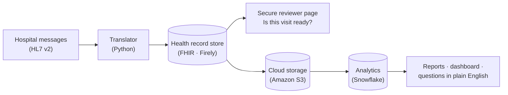
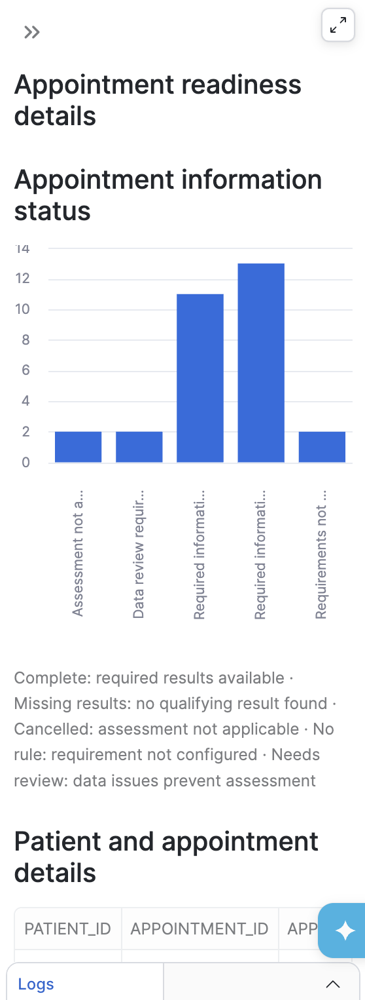

# Connected Care Data Platform

**Is the right patient information available before an appointment?** This project answers that question end to end, on synthetic data. It turns hospital messages into standard health records, shows an authorized reviewer what each visit has, and reports on readiness across visits in the cloud.


## In plain English

Before a check-up, a clinic needs certain information on file, for example a recent blood-sugar (glucose) test. That information is sent between hospital systems as short coded messages, in a decades-old format called **HL7 v2**. Results can be missing, late, or attached to the wrong patient. And an empty chart doesn't tell you whether the test was never done or simply couldn't be found.

This project:
1. **Translates** those messages into **FHIR**, the modern standard for health records, and stores them in a FHIR server.
2. **Checks each upcoming visit** against a simple rule: is there a usable glucose result from the week before? Every visit gets one of four clear answers: *ready*, *missing*, *couldn't check*, or *no rule for this visit*.
3. **Shows a signed-in reviewer** the patient, their results and the appointment on a secure page, and gives records staff a to-do list for anything missing.
4. **Sends copies to the cloud** (Amazon S3, then Snowflake) for reports, a dashboard and plain-English questions. It proves that every copy matches the original exactly, with nothing lost and nothing duplicated.



## Choose your path

| If you are… | Start with |
|---|---|
| A healthcare or business reviewer | [**Business overview**](docs/business-overview.md): the problem, users, rules, tested scenarios and requirement status. Then the [HL7 → FHIR mapping spec](docs/hl7-to-fhir-mapping.md) |
| A data or Snowflake reviewer | [**Snowflake design**](docs/snowflake-design.md): layers, idempotent loads, validation, semantic model, security and roadmap. Then the [SQL](analytics/snowflake/) |
| An engineer | [How it works](#how-it-works), [Getting started](#getting-started) and the [project history](docs/project-history.md) |
| New to healthcare data | [HL7 and FHIR explained](archive/hl7-fhir-learning-notes.md) and the [glossary](#glossary) |

## Results

| What was verified | Result | Evidence |
|---|---|---|
| Live reviewer security checks | **15 / 15** passed: 401 for anonymous users, 403 for the wrong patient or a bad CSRF token, replayed session rejected | [reviewer milestone](archive/milestone-reports/2026-10-03-reviewer-milestone.md) |
| Snowflake loads vs the exported source | **7/7, 3/3, 4/4, 5/5** rows match on ID, full payload, file and row number; **0** duplicates. Reproducible offline | [reproduce](results/README.md#reproduce-the-reconciliation) |
| Repeat loads of the same files | **0** rows added (`LOAD_SKIPPED`); typed `MERGE` reruns insert **0** | [query history](results/2026-10-06-typed-analytics/05-merge-query-history.csv) |
| Typed layer vs RAW | **0** review rows, **0** broken patient links, **0** payload mismatches | [validation](results/2026-10-06-typed-analytics/00-typed-validation.csv) |
| 30-patient failure-case batch | **30 / 30** outcomes match the expected outcome; **6 / 6** deliberately broken records flagged for review | [results](results/2026-10-07-30-patient-batch/) |
| Visit-rule edge cases | **9 / 9** time-window and status tests pass | [rule checks](results/2026-10-06-typed-analytics/04-rule-checks.csv) |
| Reference integrity on 933 official FHIR examples | **609 / 641** clinical resources resolve to a patient, exactly matching the offline benchmark | [link check](results/2026-10-08-fhir-r4-examples/patient-link-check.csv) |

## Screenshots

| Authenticated reviewer portal | Appointment readiness (Streamlit in Snowflake) | Cortex Analyst |
|---|---|---|
|  |  |  |

| Firely Auth client (public, no secret) | PKCE required | Semantic view |
|---|---|---|
|  |  |  |

## How it works


1. **HL7 v2 → FHIR.**
   - [`convert_admission.py`](converters/convert_admission.py) maps ADT^A01 to a **Patient**, matched by identifier system + MRN and never by name.
   - [`convert_lab.py`](converters/convert_lab.py) maps ORU^R01 to an **Observation** coded LOINC 2345-7 in UCUM units, with an ID derived from the source message so a replay never duplicates.
   - [`appointment_bridge.py`](converters/appointment_bridge.py) maps SIU^S12 to an **Appointment** and verifies it by reading it back.
   - Field-by-field rules: [mapping spec](docs/hl7-to-fhir-mapping.md).
2. **Information availability, not clinical clearance.** [`evaluator_v2.py`](worklist/evaluator_v2.py) applies [`policy.json`](worklist/spec/v2/policy.json): a glucose result with units, measured in the 7 days before the visit, with status final, amended or corrected. A gap is reported only after a complete, successful retrieval. Follow-up lives in a [worklist](worklist/worklist_store.py) with owners, due times and resolution history.
3. **Secured review.** [`viewer_auth.py`](worklist/viewer_auth.py) implements OpenID Connect authorization code + PKCE against Firely Auth:
   - RS256 token checks.
   - Tokens held only in server memory.
   - Secure/HttpOnly/SameSite cookies and 15-minute sessions.
   - Documents served only after a FHIR DocumentReference read, a patient and registry match, and a SHA-256 check.
4. **Export and landing.** [`export_cohort.py`](analytics/export_cohort.py) exports through the reviewer's verified session and requires two identical reads. [`land_s3.py`](analytics/land_s3.py) writes encrypted, no-overwrite S3 objects and re-checks each hash.
5. **Snowflake.**
   - RAW tables keep each `VARIANT` payload with its file, row and batch provenance.
   - Typed tables are built with insert-only `MERGE` and quality flags.
   - Rules run as SQL views.
   - A Streamlit dashboard and a Cortex Analyst semantic view sit on top.
   - Details: [Snowflake design](docs/snowflake-design.md).

## Repository layout

```
converters/                   HL7 v2 → FHIR: admissions, lab results, appointments (+ read-back check)
samples/                      Synthetic HL7 messages and their FHIR output
worklist/                     Rules engine, worklist, reviewer portal, OIDC/PKCE login, tests
documents/                    Synthetic PDF/PNG fixture served by the document gate
analytics/                    Export → S3 / stage → Snowflake pipeline, reconcilers, tests
  batches/                    Exported NDJSON batches with SHA-256 manifests
  snowflake/                  Typed layer, reports, batch loads, coverage demo (SQL)
  dashboard/                  Streamlit-in-Snowflake app
datasets/                     30-patient failure cases · FHIR R4 examples (Phase 1) · migration snapshot
results/                      Downloaded query results and verification evidence, by date
docs/                         Business overview, mapping spec, Snowflake design, project history, decks
infra/                        Docker trust-store builds · sanitized Firely Auth client configuration
archive/                      One-time scripts and working records from the build
```

## Getting started

**Requirements:** Python 3.11. The full stack also needs Docker, Firely Server and Firely Auth (evaluation licences from [Firely](https://fire.ly)), the AWS CLI and a Snowflake account.

```sh
python -m venv .venv && source .venv/bin/activate
pip install -r requirements.txt
```

**Runs offline, with no servers or cloud accounts:**

```sh
python converters/convert_lab.py samples/lab-002.hl7       # HL7 ORU → FHIR Observation JSON
python converters/appointment_bridge.py --self-test      # SIU^S12 mapping and stable-ID tests
python analytics/compare_fc30_outcomes.py          # 30-patient expected vs actual

(cd analytics && python -B -m unittest test_export test_reconcile)
(cd worklist  && python -B -m unittest test_demo_check test_viewer_auth)
(cd worklist  && python -B test_worklist.py)
```

The Snowflake reconciliations can also be rerun offline: see [Reproduce the reconciliation](results/README.md#reproduce-the-reconciliation).

**With a local Firely Server on port 8080:** `python converters/convert_admission.py samples/admission-002.hl7`

**Full stack** (Firely Server on 8081 with SQL storage, Firely Auth on 5001, reviewer portal on 8082): start from [`.env.example`](.env.example) and the [sanitized Firely Auth configuration](infra/firely-auth/appsettings.instance.example.json). Supply your own licences, TLS certificates (in `auth/certs/`) and signing key. Then follow the [runbook](archive/runbook.md) and [`worklist/README-verification.md`](worklist/README-verification.md). Set `S3_BUCKET` before using [`land_s3.py`](analytics/land_s3.py) or [`prepare_snowflake.py`](analytics/prepare_snowflake.py).

## Project timeline

| Date (2026) | Milestone |
|---|---|
| 30 Sep – 1 Oct | HL7 ADT and ORU converters with deterministic IDs |
| 2 Oct | Firely on Amazon RDS (TLS enforced) · availability rules and worklist · document gate · OIDC + PKCE |
| 3 Oct | Live reviewer milestone, 15/15 · repeatable verification tooling |
| 4 Oct | Authenticated export · private S3 landing · Snowflake integration blocked at `AssumeRole` |
| 5 Oct | Snowflake internal-stage RAW load, fully reconciled |
| 6 Oct | Typed tables, three reports, 9/9 rule tests · 30-patient failure-case dataset |
| 7 Oct | SIU^S12 bridge · local secure portal · authenticated batch export · Streamlit dashboard |
| 8 Oct | AssumeRole root cause found and fixed · 933 FHIR R4 examples loaded directly from S3 · Cortex Analyst |
| 10–13 Oct | HIPAA considerations, requirements, presentations, this repository |

The [project history](docs/project-history.md) tells the full story, with decisions and lessons learned. The Git history follows the same timeline: it was rebuilt from the project's dated checkpoints, so each commit shows the code as it was on that day.

## Known limitations

- **Bounded converters.** Only the configured message shapes are supported; this is not a general HL7 interface engine.
- **Two batch routes into Snowflake.** The first batches (5–7 Oct) used an internal stage while an AWS-managed policy blocked the S3 integration. Phase 1 (8 Oct) loaded directly from S3 after the fix.
- **Snapshot consistency** comes from two matching authenticated reads, not a transactional lock.
- **Least privilege in Snowflake is not finished:** setup used `ACCOUNTADMIN`. The fix is on the [roadmap](docs/snowflake-design.md#production-roadmap).
- **The semantic view and coverage views** were built in the Snowflake workspace; their YAML and DDL are not exported here yet.
- **Firely evaluation licences** stop the servers after 12 hours of uptime.

## Data, privacy and security

- **Synthetic data only.** Every patient is fictional (for example "Ravi Demo" or "Person02 Training") or comes from the official HL7 FHIR R4 examples. "Information availability" is never a clinical judgement. See [HIPAA considerations](docs/hipaa-considerations.md).
- **No secrets.** Licences, private keys, signing keys, `.env` files, databases and local checkpoints are excluded.
- **Placeholders.** Account IDs, the external ID, endpoints, IP addresses, security-group IDs and bucket names are replaced with placeholders such as `<AWS_ACCOUNT_ID>`, in every commit of the history.
- **How it was built.** This project was built with AI pair-programming assistants. Every result above is backed by saved evidence in [`results/`](results/), and most of it can be re-checked offline.

## Glossary

| Term | Meaning |
|---|---|
| **HL7 v2** | The long-established messaging standard hospital systems use to send events: admissions (ADT), lab results (ORU), scheduling (SIU) |
| **FHIR** | The modern health-data standard. Records are "resources" such as Patient, Observation and Appointment, exchanged over web APIs |
| **Firely Server** | A FHIR server: it stores FHIR resources and serves them through an API |
| **LOINC / UCUM** | Standard codes for lab tests (2345-7 = glucose) and for units (mg/dL) |
| **OIDC + PKCE** | A secure sign-in flow: the app never sees the password, and a stolen login code is useless without a one-time secret |
| **Amazon S3** | Cloud file storage, used here as a private landing zone |
| **Snowflake** | A cloud data platform for SQL analytics. **RAW → typed** means storing the original JSON first, then building clean tables from it |
| **Idempotent load** | Running the same load twice adds nothing the second time |
| **Cortex Analyst** | Snowflake's feature for asking data questions in plain English, guided by a semantic model |

## Documentation

| Document | Contents |
|---|---|
| [Business overview](docs/business-overview.md) | Problem, users, workflow, rules, outcomes, tested scenarios, requirements traceability |
| [HL7 → FHIR mapping](docs/hl7-to-fhir-mapping.md) | Field-level interface spec for ADT, ORU and SIU, with validation and identity rules |
| [Snowflake design](docs/snowflake-design.md) | Objects, RAW and typed layers, idempotency, proofs, security, cost, roadmap |
| [Project history](docs/project-history.md) | Phase-by-phase build log, decisions and lessons learned |
| [Milestone reports](archive/milestone-reports/) | Dated working reports with exact checks and query IDs |
| [Runbook](archive/runbook.md) | Working start-of-day and end-of-day runbook used during the build |
| [HIPAA considerations](docs/hipaa-considerations.md) | Safeguards mapped to the project, and their limits |
| [Requirements document](docs/BRD-FRD-and-Progress.docx) | Original BRD/FRD and delivery plan, version 3.0 (Word) |
| [Presentations](docs/presentations/) | Platform deck, consulting edition, analytics demo, beginner guide, LinkedIn carousel (PowerPoint) |
| [Results](results/README.md) | Index of the evidence, and how to reproduce the reconciliation |

## Acknowledgements

FHIR® and HL7® are registered trademarks of Health Level Seven International. The Phase 1 dataset is derived from the [official FHIR R4 examples](https://hl7.org/fhir/R4/downloads.html), used under the [FHIR licence](https://hl7.org/fhir/R4/license.html). Firely Server and Firely Auth are products of [Firely](https://fire.ly) and are not redistributed here. Parsing uses [hl7apy](https://github.com/crs4/hl7apy).
