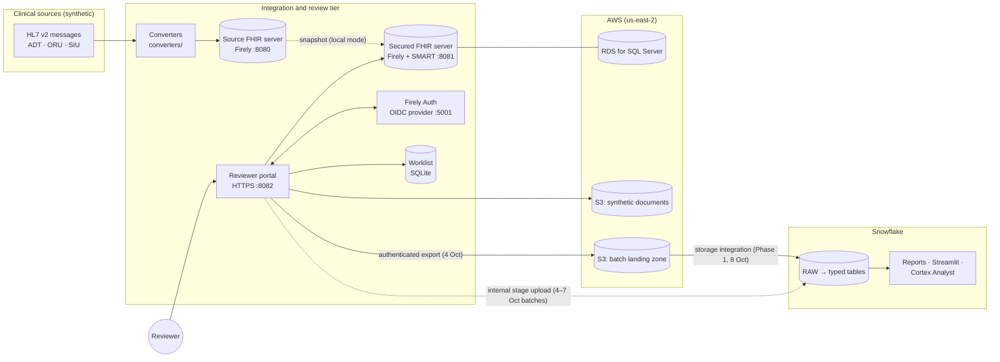
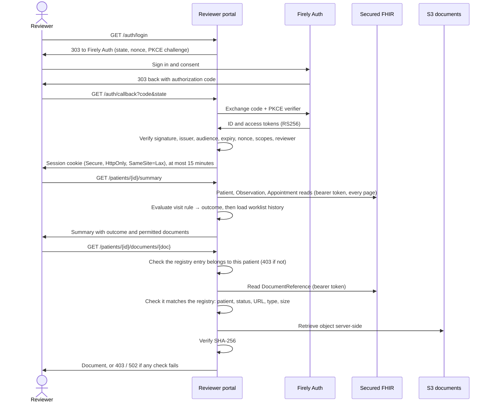

# Architecture

How the platform is put together: the components and where they run, the three runtime flows, and the security controls at each trust boundary. For the reasoning behind the main choices, see [decisions](decisions.md); for the Snowflake side in depth, see [Snowflake design](snowflake-design.md).

## System context

## Components

| Component | Technology | Where | Responsibility |
|---|---|---|---|
| Converters | Python, hl7apy | [`converters/`](../converters/) | Validate supported HL7 v2 messages, map them to FHIR R4 with deterministic IDs; the appointment bridge also writes to the source server |
| Source FHIR server | Firely Server (Docker) | `localhost:8080` | Receives converted resources |
| Secured FHIR server | Firely Server with SMART on FHIR authorization (Docker) | `localhost:8081` | Serves the reviewer portal. Backed by Amazon RDS for SQL Server from 2 to 7 Oct, then by a protected local snapshot of the source server ("local mode") |
| Authorization server | Firely Auth (Docker) | `https://localhost:5001` | Reviewer sign-in, consent, RS256-signed tokens |
| Mail catcher | Mailpit (Docker) | `localhost:8025` | Receives Firely Auth email in the local environment |
| Reviewer portal | Python `ThreadingHTTPServer` over TLS | `https://localhost:8082` ([`worklist/`](../worklist/)) | Login, patient summary, rule assessment, worklist history, document gate, batch export |
| Rules engine | Python | [`evaluator_v2.py`](../worklist/evaluator_v2.py) + [`policy.json`](../worklist/spec/v2/policy.json) | Information-availability outcome for each visit |
| Worklist | SQLite | `worklist/data/` (not committed) | Work items and their history, kept apart from clinical data |
| Database | Amazon RDS for SQL Server Express | AWS us-east-2 | Storage for the secured FHIR server |
| Document store | Amazon S3, private bucket | AWS | Synthetic PDF and PNG documents |
| Landing zone | Amazon S3, private prefix per batch | AWS | Exported NDJSON batches and their manifests |
| Analytics | Snowflake: stages, RAW and typed tables, views, Streamlit, Cortex Analyst | Snowflake | Loading, modeling, reports and natural-language questions |

## Runtime flows

### 1. Ingestion: message to FHIR resource

1. A converter parses the HL7 v2 message and rejects anything outside its supported shape: wrong message type, unknown identifier authority, non-final or non-numeric result, missing timezone.
2. Identity is resolved by identifier (system + MRN), never by name. Resource IDs are UUID5 hashes of the source keys, so a replayed message overwrites the same resource instead of creating a new one.
3. The converted resource is saved as FHIR JSON and loaded into the source FHIR server under its stable ID. The appointment bridge creates the Appointment with a `PUT` on its stable ID only if it doesn't exist yet (an existing one is left unchanged), then reads it back and compares it with the conversion before anything is exported.

### 2. Review: sign-in, assessment and documents

Since 7 October the portal has run in local mode, which answers document requests with 503 (downloads deferred).

### 3. Analytics: export to Snowflake

1. **Export.** Each export reads the cohort twice and only proceeds if both reads match. The 4 Oct and portal-refresh batches were read through the reviewer's verified session; the two HL7 bridge batches were read from the local source server. It writes one NDJSON file per resource type and a manifest with counts, IDs and SHA-256 hashes.
2. **Land.** The 4 Oct batch went to a private S3 prefix (encrypted, conditional writes, re-downloaded and hash-checked). With the S3 integration blocked until 8 Oct, it and the 7 Oct batches were loaded through Snowflake internal stages; the S3 route then loaded the Phase 1 examples.
3. **Load.** `COPY INTO` loads named files only, keeping file and row provenance, with `ON_ERROR = ABORT_STATEMENT` and `FORCE = FALSE`. Insert-only `MERGE` builds the typed tables. Reports, the Streamlit dashboard and the Cortex Analyst semantic view read from those.
4. **Prove.** The RAW rows are downloaded and reconciled against the exported files ([`make reconcile`](../Makefile)), and the identical load is repeated to show that it adds nothing.

## Trust boundaries and controls

| Boundary | Controls |
|---|---|
| Browser ↔ portal | TLS 1.2+; `Host` header pinned to the portal; random session IDs in Secure/HttpOnly/SameSite=Lax cookies; sessions of at most 15 minutes; CSRF token plus `Origin` check on logout |
| Portal ↔ Firely Auth | OIDC authorization code with PKCE for a public client (no secret); browser-bound, single-use, expiring `state`; nonce; RS256 checks on issuer, audience, expiry, client, scopes and reviewer identity; locally trusted CA |
| Portal ↔ secured FHIR | Per-request bearer token held in a context variable (never shared across threads or written to disk); requests and redirects allow-listed to the configured server; complete pagination with loop and page-count limits |
| Portal ↔ document store | Retrieval only after an authorized DocumentReference read for the same patient; registry, status, content-type, size and SHA-256 checks; wrong-patient and unregistered requests return 403 |
| Secured FHIR ↔ RDS | `Encrypt=True`, `TrustServerCertificate=False`, RDS CA bundle in the image's trust store, ingress limited to single-address (/32) rules |
| Export ↔ S3 | AES-256 server-side encryption, no-overwrite conditional writes, re-download hash verification, public access blocked |
| S3 ↔ Snowflake | Storage integration trusting one Snowflake principal with an external ID; IAM role limited to read and list on batch prefixes (the committed policy covers the first batch's; Phase 1's prefix was read through the same integration, a change not recorded here) |

## Environments

Everything ran on one workstation (Docker Desktop) against AWS us-east-2 and a Snowflake account, using synthetic data only. The design leaves two clear seams for production:
- **Hosting.** The FHIR servers, Firely Auth and the portal would move to a managed container platform in a private network.
- **Interfaces.** The converters would sit behind an interface engine. Identity would come from an enterprise master patient index rather than a single identifier rule.

The [Snowflake roadmap](snowflake-design.md#production-roadmap) covers the analytics side.

---

**Reading order 5 of 12** · ← [Walkthrough](walkthrough.md) · [Decisions](decisions.md) → · [README](../README.md)
