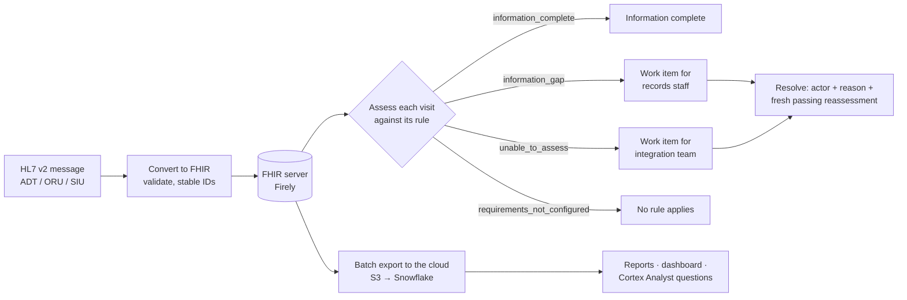

# Business overview

For healthcare operations, product and techno-functional readers: the problem, who the platform serves, the business rules, what was tested, and how the delivered work traces back to the requirements. All data is synthetic. Nothing here is a clinical decision.

## The problem: pre-visit readiness

Before many appointments, someone has to confirm that the information the clinician expects is actually on file. For example, a glucose result from the week before a diabetes review. That information arrives from different systems:

| Source event | Typical HL7 v2 message | What it carries |
|---|---|---|
| Admission | ADT^A01 | Patient identity and demographics |
| Lab result | ORU^R01 | The test, value, unit, status and time |
| Scheduling | SIU^S12 | The appointment, its service and its time |

Chart preparation by hand is slow, and it hides an important distinction. An empty chart can mean the test was never done, or that the result exists but could not be retrieved or trusted: wrong patient link, missing unit, preliminary status, impossible timestamp. Those need different people and different actions. This platform makes that distinction explicit for every visit.

## Who it serves

| Role | What they get |
|---|---|
| Records / front-desk staff | A worklist of visits with a genuine information gap, each with a due time, an owner and the evidence behind it (kept in a SQLite store; a staff-facing screen is not built yet) |
| Reviewer (clinician or nurse) | A signed-in, read-only view of the patient, qualifying results, the appointment and permitted documents |
| Integration / IT team | Problems that are data or interface faults (identity, retrieval, invalid data), routed to them instead of to records staff |
| Operations / analytics lead | Readiness across visits in Snowflake: reports, a dashboard and natural-language questions ([Cortex Analyst](cortex-analyst.md)) |

## How the workflow runs

## The business rule

The demonstration policy ([`policy.json`](../worklist/spec/v2/policy.json), `demo-previsit-v2`) defines one visit profile, `demo-lab-review`:

| Setting | Value |
|---|---|
| Required information | A glucose result: LOINC `2345-7`, numeric, with a unit |
| Time window | The 7 days before the appointment. The window start is included; the appointment time itself is excluded |
| Accepted result status | final, amended, corrected (preliminary results do not count) |
| Missing or ambiguous result time | `unable_to_assess`, never a silent pass or fail |
| Work-item due time | 24 hours before the appointment. This is an administrative target, not medical urgency |
| Clinical validation | `not_validated`: a demonstration rule, not a clinical guideline |

Rules are configuration, not code. A new visit type means a new profile with its own codes, window and statuses.

## The four outcomes

| Outcome | Meaning | Who acts | Example from the demo |
|---|---|---|---|
| `information_complete` | Every configured requirement has a qualifying record | No one | Ravi Demo: two final glucose results (95 and 102 mg/dL) in the window |
| `information_gap` | Retrieval succeeded completely and nothing qualifies | Records staff: "Investigate availability and request records" | Person02 Training before the result arrived; FC30 patients whose only results were preliminary or outside the window |
| `unable_to_assess` | Identity, retrieval or required data was incomplete or invalid | Integration team | FC30 patients whose results carry an impossible timestamp |
| `requirements_not_configured` | No visit profile applies | Nobody acts until a rule exists | FC30 appointments deliberately left without a rule |

The Snowflake report adds a fifth value, `not_applicable`, for cancelled visits. The UI label is always **"Information availability, not clinical clearance."**

## Guardrails built into the rules

- **Identity by identifier, never by name.** Patients match on identifier system + value. Name-only matching is disabled, ambiguous mappings go to manual review, and unresolved references are quarantined, not relinked.
- **Partial results never prove absence.** Every result page must be retrieved before a gap is reported. In the rules engine a failed page makes the visit `unable_to_assess`; the live portal stops with an error (HTTP 502) instead of showing an outcome.
- **Zero is not a clinical fact.** "No linked allergy records in this batch" never means "the patient has no allergies".
- **Replays are safe.** Replaying a message creates no extra record or work item. The policy also declares how corrections, cancellations and out-of-order updates should be handled, but the converters don't implement them yet: the lab converter accepts only final results, and the appointment bridge rejects cancellations (SIU^S15).
- **Work items carry evidence and history.** Each item records its policy, evidence, owner, permitted action and due time. Resolving needs an actor in the owning role, a reason and a fresh passing reassessment, and a reappearing issue reopens the same item ([exported history](../results/2026-10-02-worklist-assessment/worklist-history.json)).
- **A link is not access.** Documents are released only through the authorized document service after patient, registry and SHA-256 checks.

## What was tested

**Two demo patients, end to end** (live, 3 October). Ravi was `information_complete`. Person02 Training went from gap to work item to resolved, with the full history kept (created by the assessment engine, then in review and resolved by a records user). The reviewer saw both patients, their results, their appointments and Person02's documents ([reviewer milestone](../archive/milestone-reports/2026-10-03-reviewer-milestone.md)).

**A 30-patient failure-case catalogue** ([dataset](../datasets/fc30-failure-cases/), loaded into Snowflake on 7 October):

| Scenario | Appointments | Expected outcome |
|---|---:|---|
| Complete | 8 | information_complete |
| Missing birth date (does not affect the rule) | 3 | information_complete |
| No observations | 3 | information_gap |
| Results outside the 7-day window | 3 | information_gap |
| Preliminary results only | 3 | information_gap |
| Result exactly at the appointment time | 2 | information_gap |
| Cancelled appointment | 2 | not_applicable |
| No rule configured | 2 | requirements_not_configured |
| Impossible result timestamp | 2 | unable_to_assess |
| Result linked to an unknown patient | 2 | information_gap, held for reference review |

**Result: all 30 appointment outcomes match the expected outcome, and all 6 deliberately broken observations were flagged for review**, without being dropped or silently relinked ([per-appointment results](../results/2026-10-07-30-patient-batch/availability-by-appointment.csv), [flagged records](../results/2026-10-07-30-patient-batch/needs-review-observations.csv)). You can rerun the comparison with `python analytics/compare_fc30_outcomes.py`.

**Rule edge cases.** 9/9 predicate tests pass in Snowflake: window start, one second before the window, one second before the appointment, exactly at the appointment, preliminary, amended, corrected, equivalent timezone, missing time ([results](../results/2026-10-06-typed-analytics/04-rule-checks.csv)).

## Requirements traceability

Business requirements and the AWS/Snowflake functional requirements from the [requirements document](BRD-FRD-and-Progress.docx) (version 3.0, 3 October), with what was delivered.

| Requirement | Delivered | Status | Evidence |
|---|---|---|---|
| BR01 Reliable healthcare record foundation | Firely FHIR server on Amazon RDS for SQL Server with enforced TLS | Done | [project history §2](project-history.md#2-cloud-database-worklist-documents-and-login-2-oct) |
| BR02 Correct patient and laboratory identity | Identifier-based matching, deterministic resource IDs, unknown-patient rejection | Done | [mapping spec](hl7-to-fhir-mapping.md) |
| BR03 Useful supported visit information | Patient, lab results, appointments and documents in one reviewer view | Done | [reviewer milestone](../archive/milestone-reports/2026-10-03-reviewer-milestone.md) |
| BR04 Controlled reviewer access | OIDC + PKCE login; 15/15 live reviewer checks, including the access denials | Done | [repeatable verification](../archive/milestone-reports/2026-10-03-repeatable-verification.md) |
| BR05 Traceable pre-visit follow-up | Worklist with owners, due times, resolution rules and history | Done | [worklist history](../results/2026-10-02-worklist-assessment/worklist-history.json) |
| BR06 Protect the demo and retain evidence | Read-only exports, checkpoints, dated evidence for every milestone | Done | [results](../results/) |
| FR30 Bounded extract with manifest | Two-read authenticated export, SHA-256 manifest | Done | [S3 landing](../results/2026-10-04-s3-landing/) |
| FR31 Private, encrypted S3 landing | Conditional AES-256 writes, re-download hash check | Done | [S3 landing](../results/2026-10-04-s3-landing/) |
| FR32 Snowflake storage integration and external stage | Scoped integration and prefix-scoped role. Blocked by an AWS-managed policy from 4 to 7 Oct; fixed on 8 Oct and used for the Phase 1 load | Done (8 Oct) | [project history §8](project-history.md#8-s3--snowflake-fixed-and-phase-1-examples-8-oct) |
| FR33 COPY JSON into RAW `VARIANT` with metadata | Every batch loaded with file, row, batch and load-time metadata | Done | [internal stage](../results/2026-10-05-internal-stage/) |
| FR34 Typed tables and visit view | Typed Patient, Observation and Appointment tables; availability computed per appointment in SQL | Done; no separate assessment-snapshot table | [typed SQL](../analytics/snowflake/typed-analytics.sql) |
| FR35 Three SQL outputs | Visit information availability ✓ · laboratory history (glucose timeline) ✓ · cohort record presence, in place of the planned worklist summary | Partly: worklist summary not built in Snowflake | [reports](../results/2026-10-06-typed-analytics/) |
| FR36 Counts, IDs, links and duplicate-free replay | Independent reconciliation; repeat loads add 0 rows | Done | [reconciliation](../results/README.md#reproduce-the-reconciliation) |
| FR37 Evidence, README and walkthrough | This repository: README, an end-to-end [walkthrough](walkthrough.md), dated milestone reports and evidence re-checked in CI | Done | [README](../README.md) |

FR30–FR35 deliver BR07 (land synthetic data in AWS and analyze it in Snowflake), and FR36–FR37 deliver BR08 (repeatable, bounded acceptance). Deferred by design in version 3.0: cloud hosting of the application, the 10-patient fixture expansion, broad HL7 support, orchestration and scale testing.

## What the data model makes measurable

These measures are supported by the tables and worklist history. They were not measured on real operations.

- **Readiness rate**: the share of booked visits that are `information_complete` N days before the appointment.
- **Gap aging**: the time from work-item creation to resolution, by owner role.
- **Data-quality rate**: `unable_to_assess` by cause (identity, retrieval, invalid data), which is effectively an interface-health indicator.
- **Coverage**: the share of patients with linked records per resource type (see the Phase 1 [coverage demo](../analytics/snowflake/Snowflake-Coverage-Demo.sql)).

## What production would add

This is a demonstration on synthetic data. A real deployment would also need an enterprise master patient index rather than a single identifier rule, an interface engine (for example Mirth Connect or Rhapsody) for feeds and replay, terminology mapping for local codes and units, a production Firely license and hosting, audit logging, consent handling, business associate agreements and a formal HIPAA risk assessment. See [HIPAA considerations](hipaa-considerations.md).

---

**Reading order 2 of 12** · ← [Project tour](tour.md) · [Background: HL7 v2 and FHIR](background-hl7-fhir.md) → · [README](../README.md)
