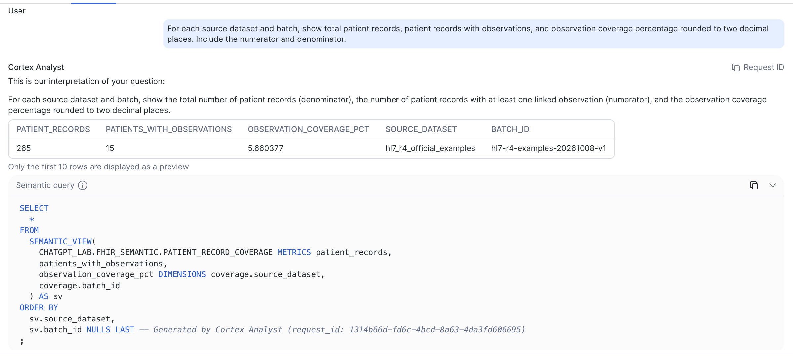
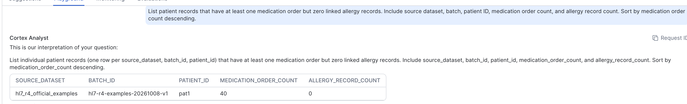
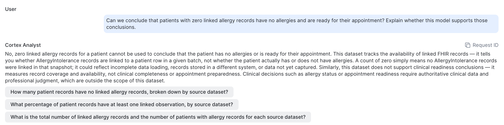
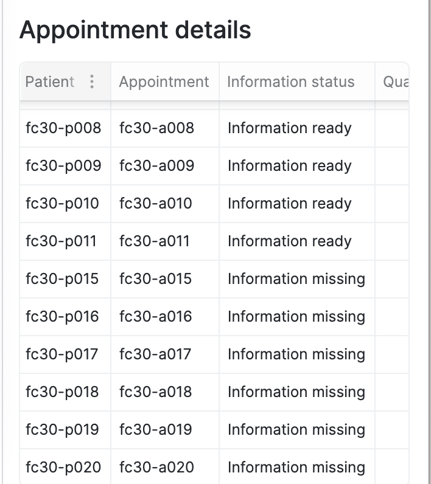

# Cortex Analyst: questions in plain English

For anyone who needs numbers from the platform but doesn't write SQL (operations leaders, records staff, quality and compliance teams) and for the engineers who make that possible. All data is from the official HL7 FHIR R4 examples. Nothing here is a clinical decision.

**On this page:** [In one paragraph](#in-one-paragraph) · [Why this project uses it](#why-this-project-uses-it) · [What it answered](#what-it-answered) · [Who benefits, without writing code](#who-benefits-without-writing-code) · [What it gives developers](#what-it-gives-developers) · [Where the Streamlit dashboard fits](#where-the-streamlit-dashboard-fits) · [Why it matters now](#why-it-matters-now) · [Why it has become a deciding factor](#why-it-has-become-a-deciding-factor) · [Limits and guardrails](#limits-and-guardrails) · [References](#references)

## In one paragraph

Cortex Analyst is Snowflake's built-in, fully managed text-to-SQL service. You type a question in ordinary English. It reads a **semantic view**, a model that records what the tables *mean*: what counts as a patient record, how coverage is calculated, which caveats apply. From that it writes SQL, runs it in your own warehouse under your own role, and returns the result together with its reading of your question and the SQL it used. It stays inside Snowflake's governance boundary. It does not train on customer data, it follows role-based access control, and with the default Snowflake-hosted models no data or prompts leave Snowflake.[1](#references)

## Why this project uses it

The platform answers one operational question: *is the right information on file before the visit?* Most of the people who ask that question are not engineers. Cortex Analyst fits for three reasons:

1. **The people asking aren't the people who write SQL.** A records lead shouldn't need to raise a ticket and wait for an analyst to learn which patients have a medication order but no allergy record on file.
2. **In healthcare, the caveat is part of the answer.** In this data a zero means *no linked record in this batch*, not *the patient has no allergies*. That rule is written once into the semantic view, so every answer carries it, whoever asks.
3. **Every answer can be checked.** Cortex Analyst shows how it read the question and the SQL it ran, and this project compares its answers with independently computed benchmarks.

## What it answered

The semantic view `PATIENT_RECORD_COVERAGE` sits on `HL7_PATIENT_COVERAGE`. That view has one row per Patient in the 933-resource HL7 R4 examples batch (265 patients), with linked-record counts in nine categories. Its description reads: *"Zero means no matching linked records in the loaded batch, not absence of a clinical condition."*

| Question, typed in English | Cortex Analyst's answer | Checked against |
|---|---|---|
| For each dataset and batch, how many patient records, how many with observations, and the coverage percentage? | **265** patient records, **15** with at least one observation, **5.66%** | Offline benchmark: 265 patients, 15 with observations ([demo SQL](../analytics/snowflake/Snowflake-Coverage-Demo.sql)) ✅ |
| Which patients have at least one medication order but zero linked allergy records? | One patient, `pat1`: **40** medication orders, **0** allergy records | Benchmark: one patient in the medication-order cohort, with no allergy record; 40 resolved MedicationRequests ([link check](../results/2026-10-08-fhir-r4-examples/patient-link-check.csv)) ✅ |
| Can we conclude that patients with zero allergy records have no allergies and are ready for their appointment? | **No.** The data measures whether records are linked, not clinical status or readiness. It then offers three questions it *can* answer | The semantic view's description ✅ |

*Cortex Analyst restates the question, returns the numerator and denominator, and shows the query it generated against the semantic view. One thing to notice: the question asked for two decimal places, but the percentage came back unrounded (5.660377), because the query returns the metric exactly as defined. This is why the SQL is always on screen. A developer fixes this kind of gap once, centrally (see [below](#what-it-gives-developers)), instead of each user working around it.*

*A patient-level list from a one-sentence request. For a records team, this is a ready-made work list.*

*The guardrail at work. Asked to draw a clinical conclusion the data can't support, Cortex Analyst declines and explains why: zero linked records could mean incomplete loading, records held in another system, or data not yet captured. It then suggests three questions the data can answer.*

## Who benefits, without writing code

Each person types a question and gets a table, a plain-English reading of the question, and the SQL behind the answer. The semantic view in place today covers record coverage in the FHIR examples. Questions marked † need a second semantic view over the appointment-readiness report (`APPOINTMENT_FC30_REPORT`), which is next on the [roadmap](snowflake-design.md#production-roadmap).

| Who | A question they might ask | What they get instead of a report request |
|---|---|---|
| Operations or clinic manager | † "How many of next week's diabetes reviews are missing a qualifying glucose result?" | A count and a list in seconds |
| Records and front-desk leads | "Which patients have a medication order but no allergy record on file?" | A work list they can act on today |
| Quality, compliance and audit | "What share of patient records have at least one linked observation?" | The figure with its numerator, denominator and exact SQL, ready for the audit file |
| Clinical informatics | "Which record types are thinnest in this source?" | Coverage gaps by category before a new feed goes live |
| Integration team | "Which batch has the lowest observation coverage?" | A comparison across loads, without writing queries |
| Executives and sponsors | † "What share of last month's appointments had complete information?" | A headline number with its definition attached |

The pattern isn't specific to healthcare. A finance team asking about margin by region, or a sales team asking about pipeline by stage, works the same way. Only the semantic view changes.

## What it gives developers

For an engineer, the value of Cortex Analyst isn't that it writes SQL. It's that the business meaning lives in one governed place, and every front end reuses it.

- **Define meaning once.** Metrics (`patient_records`, `patients_with_observations`, `observation_coverage_pct`), dimensions, synonyms and descriptions live in the semantic view. Change a definition and every answer changes with it, with no scattered reports to hunt down.
- **Build in the domain knowledge.** The description *"zero means no matching linked records… not absence of a clinical condition"* is how a developer makes sure a non-technical user gets the whole answer, including what the data can't tell them. The third screenshot shows it working.
- **Tune without retraining anything.** Custom instructions for question categorization and SQL generation can fix gaps like the rounding above (for example, "round percentages to two decimal places"). Verified queries steer questions that must be answered one exact way toward the approved SQL.
- **Test it like code.** The [metric catalogue](../datasets/phase1-fhir-examples/METRIC_CATALOGUE.md) sets out grain, exclusions and 15 evaluation questions, and the demo SQL holds expected results for them. The semantic view editor in Snowsight also has *Evaluations* and *Monitoring* tabs, for measuring accuracy against verified answers and reviewing the questions people actually ask.
- **One model, many front ends.** The same semantic view serves the Snowsight playground, a Streamlit app, Slack or Teams through the REST API, and Cortex Agents.[1](#references)
- **Security is inherited, not rebuilt.** The generated SQL runs under the asker's role, so grants, masking and row-access policies still apply.

**What this means for someone's working day.** A records lead starts the morning by typing one question into a chat box instead of filing a ticket. The developer's work happened earlier: deciding what "coverage" means, writing the caveat into the model, and adding verified queries for the questions asked every day. The records lead gets a table, a plain-English reading of the question and suggested follow-ups, and never needs to know what a join is.

## Where the Streamlit dashboard fits

The dashboard and Cortex Analyst handle different kinds of question, and the project uses both.

| | Streamlit dashboard | Cortex Analyst |
|---|---|---|
| Best for | The same questions, every day | New questions as they come up |
| What the user does | Picks a dataset, filters by status or patient, downloads a CSV | Types a question |
| What the developer maintains | Python and SQL ([`firely_streamlit_app.py`](../analytics/dashboard/firely_streamlit_app.py)) | A semantic view |
| In this project | Appointment information status, patient and appointment details, a data-quality review queue | Record coverage across nine categories for 265 patients |

| Appointment information status (Streamlit in Snowflake) | Appointment details (Streamlit in Snowflake) |
|---|---|
|  |  |

The dashboard runs on the warehouse runtime with Snowpark, so it needs no external credentials. It reads the 30-patient failure-case batch and the verified HL7 sample. The next step brings the two together: an *Ask a question* box in the dashboard that calls Cortex Analyst through its REST API, which Snowflake supports in Streamlit in Snowflake.[1](#references)

## Why it matters now

- **Language models got good at SQL, but not on raw schemas.** In Snowflake's internal evaluation on real-world business questions, a single prompt to GPT-4o reached 51% accuracy, while Cortex Analyst, working from a semantic model, scored above 90%.[3](#references) Those are vendor-reported figures, but the lesson holds: accuracy comes from the semantic layer, not from the model alone.
- **Semantic models became database objects.** In June 2025 Snowflake introduced semantic views as native schema-level objects.[4](#references) Business definitions can now be granted, shared and versioned like tables, instead of living in a file next to one BI tool.
- **Governance moved inside the platform.** Earlier text-to-SQL tools meant pasting schemas, and sometimes data, into an outside chatbot. Running inside Snowflake under role-based access is what makes this usable for regulated data. In healthcare, that is the difference between a demo and something a compliance officer can approve.
- **The analyst queue is the bottleneck.** Business questions often wait days for an analyst. Snowflake built Cortex Analyst to let people answer them directly.[2](#references)

## Why it has become a deciding factor

When an organization chooses or renews a data platform, the question is no longer only *"can it store and process our data?"* It is also *"can the people who run the business ask it questions, safely, without a ticket?"* Governed, explainable natural-language answers tied to agreed definitions remove the analyst bottleneck without creating a second, unofficial version of the truth. A platform that can't offer that now starts at a disadvantage.

In healthcare the *governed* half isn't optional. An AI answer that drops the caveat, reading "zero records" as "no allergies", is worse than no answer at all. This project shows both halves: the convenience, and the guardrail that keeps it honest.

## Limits and guardrails

- **SQL-answerable questions only.** Cortex Analyst answers what can be resolved with SQL over the semantic view. It doesn't produce open-ended insights, it doesn't reuse earlier results in follow-up questions, and long conversations are best reset.[1](#references)
- **Check the SQL for anything that matters.** The rounding example above is small, but it is the kind of gap that only shows up if someone reads the query.
- **Current scope.** There is one semantic view, over the FHIR examples. Its YAML is not yet exported to this repository; that is the first item on the [roadmap](snowflake-design.md#production-roadmap).
- **Real patient data needs more.** Confirm that the business associate agreement covers Cortex features, and the models and regions in use, before any PHI reaches a prompt or a result. See [HIPAA considerations](hipaa-considerations.md).
- **The direction of travel.** Snowflake now recommends Cortex Agents for new builds. Agents use the same semantic views, so this model carries over unchanged.[1](#references)

See also: [Cortex Code](cortex-code.md), which works on the platform itself rather than answering business questions, and the [Snowflake design](snowflake-design.md#semantic-layer-and-apps).

## References

1. Snowflake documentation. [Cortex Analyst](https://docs.snowflake.com/en/user-guide/snowflake-cortex/cortex-analyst): semantic views, REST API and integrations, data governance, limitations.
2. Snowflake. [Cortex Analyst: Paving the Way to Self-Service Analytics with AI](https://www.snowflake.com/en/blog/cortex-analyst-ai-self-service-analytics/) (public preview announcement), August 2024.
3. Snowflake Engineering. [Snowflake Cortex Analyst: Evaluating Text-to-SQL Accuracy for Real-World Business Intelligence Scenarios](https://www.snowflake.com/en/engineering-blog/cortex-analyst-text-to-sql-accuracy-bi/). Internal evaluation, vendor-reported.
4. Snowflake Engineering. [Snowflake's Native Semantic Views: Unlocking Easy, Efficient and Trusted AI-Powered BI for the Enterprise](https://www.snowflake.com/en/blog/engineering/native-semantic-views-ai-bi/), June 2025.
