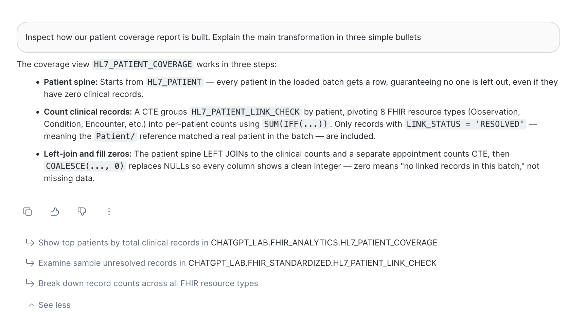
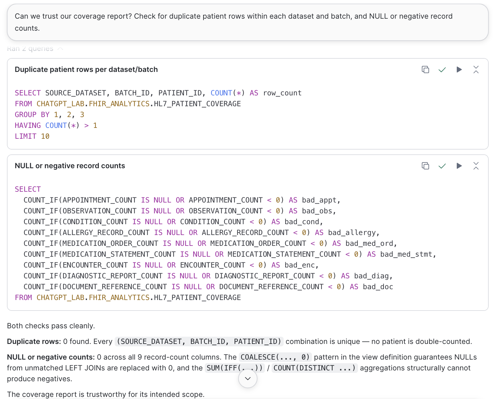
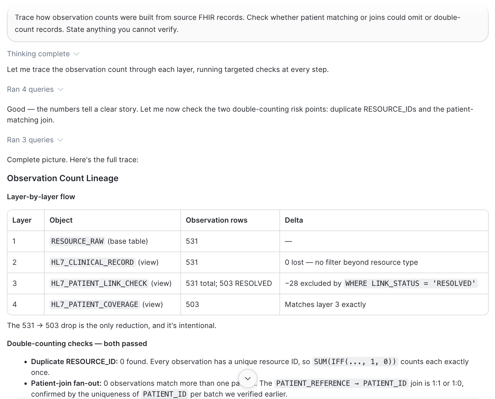
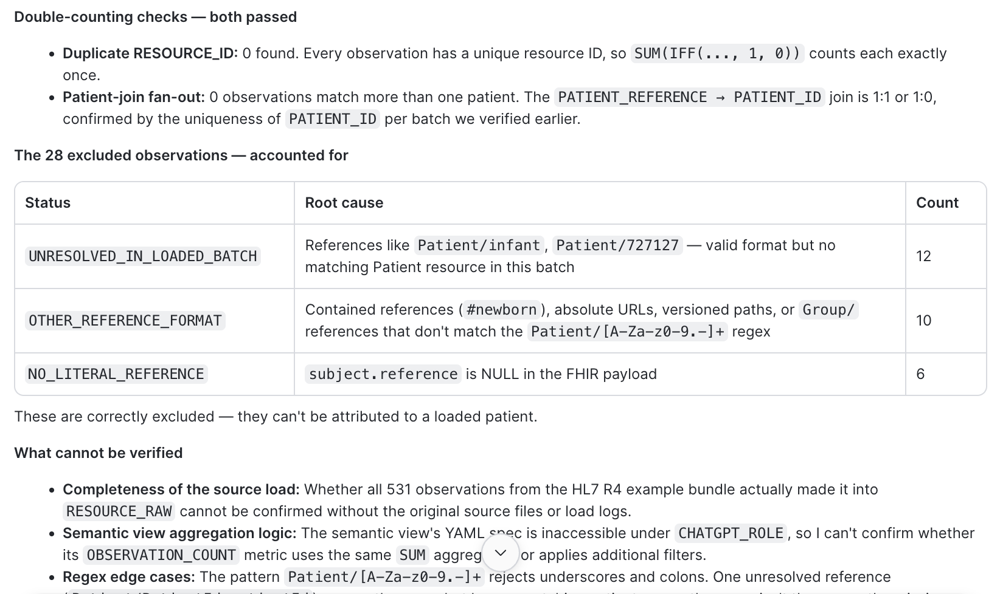
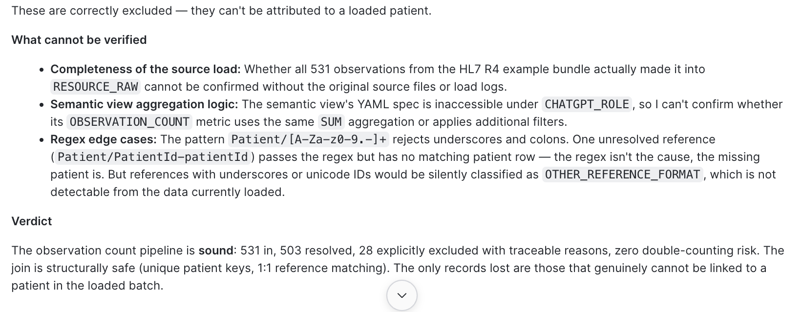
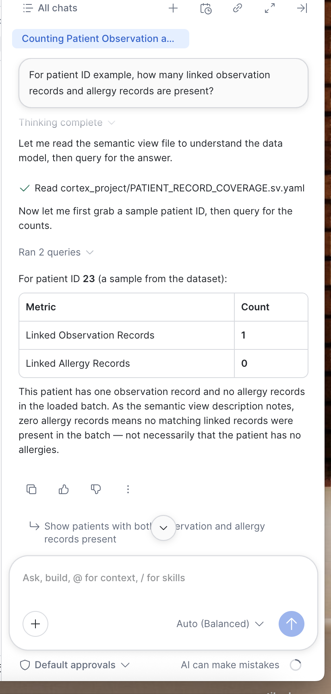

# Cortex Code: an AI engineer inside Snowflake

For anyone who needs to understand, check or explain the data platform without writing the queries themselves (reviewers, auditors, product owners, new team members) and for the engineers who build it. All data is from the official HL7 FHIR R4 examples. Nothing here is a clinical decision.

**On this page:** [In one paragraph](#in-one-paragraph) · [Why this project uses it](#why-this-project-uses-it) · [What it did here](#what-it-did-here) · [Who benefits, without writing code](#who-benefits-without-writing-code) · [What it gives developers](#what-it-gives-developers) · [Why it matters now](#why-it-matters-now) · [Why it has become a deciding factor](#why-it-has-become-a-deciding-factor) · [Limits and guardrails](#limits-and-guardrails) · [References](#references)

## In one paragraph

Cortex Code is Snowflake's agentic AI assistant, built into Snowsight and Workspaces and also available as a command-line tool. It became generally available in Snowsight on 9 March 2026.[1](#references) You describe a task in English. It finds the relevant tables using catalog metadata and lineage, writes and runs SQL or Python, explains existing code, and suggests fixes when a statement fails. Before applying any change, it shows the proposed edit as a diff for review. It can also answer governance and cost questions, such as who can access what, or which queries drive credit spend. Throughout, it works within the account's existing policies and role-based access.[1](#references)

### How it differs from Cortex Analyst

| | [Cortex Analyst](cortex-analyst.md) | Cortex Code |
|---|---|---|
| Works on | Business questions over a curated semantic view | The platform itself: tables, views, SQL, notebooks, pipelines |
| Typical user | Someone who wants a number or a list | Someone who wants to know *how* a number is made, whether to trust it, or to build something new |
| Output | A result table, its reading of the question, and the SQL | Queries it ran, explanations, checks, proposed code changes |
| In this project | Record coverage for 265 patients | Explaining, auditing and tracing the coverage pipeline |

## Why this project uses it

1. **An independent check of the numbers.** This project's central claim is that its numbers can be trusted. Given read-only instructions, Cortex Code re-derived the observation count layer by layer and arrived at exactly the offline benchmark: 531 observations in, 503 attributed to a patient, 28 excluded, each for a stated reason.
2. **Explaining the build to people who didn't build it.** Asked for "three simple bullets", it read the view definition and explained the transformation in terms a product owner can follow.
3. **Faster building, inside guardrails a developer sets.** The standing instruction at the top of [`Snowflake-Coverage-Demo.sql`](../analytics/snowflake/Snowflake-Coverage-Demo.sql) has it run read-only `SELECT`s only. It must not change tables, permissions, warehouses or semantic definitions. It must show the SQL, filters and denominator. It must never substitute a patient or call a missing record an absent condition. The [metric catalogue](../datasets/phase1-fhir-examples/METRIC_CATALOGUE.md) ends with a similar brief for the next build step: inspect read-only first, then generate reviewed SQL and expected-result checks before any write.

## What it did here

### 1. "Inspect how our patient coverage report is built. Explain the main transformation in three simple bullets."

It explained that the view starts from every patient in the batch, so no one is left out. It then counts only records whose patient reference actually resolved, and fills empty categories with zero, meaning "no linked records in this batch", not "missing data".

### 2. "Can we trust our coverage report? Check for duplicate patient rows… and NULL or negative record counts."

It wrote and ran two checks, both of which passed: **0** duplicate patients per dataset and batch, and **0** NULL or negative values across all nine count columns. It also explained *why* the second result is guaranteed by the view's design (`COALESCE(…, 0)`, and `SUM(IFF(…))` can't go negative), not just observed.

### 3. "Trace how observation counts were built from source FHIR records… State anything you cannot verify."

It ran seven queries and produced a lineage trace:

| Layer | Object | Observations | What changed |
|---|---|---|---|
| 1 | `RESOURCE_RAW` | 531 | – |
| 2 | `HL7_CLINICAL_RECORD` | 531 | Nothing lost |
| 3 | `HL7_PATIENT_LINK_CHECK` | 531, of which 503 resolved | 28 excluded: **12** unresolved in the batch, **10** other reference formats, **6** with no literal reference |
| 4 | `HL7_PATIENT_COVERAGE` | 503 | Matches layer 3 exactly |

It also confirmed there were no duplicate resource IDs and no join fan-out, so nothing was counted twice. Every figure matches the project's offline [link check](../results/2026-10-08-fhir-r4-examples/patient-link-check.csv) (Observation: 503 resolved, 12 unresolved, 10 other format, 6 no literal reference). Just as useful, it listed what it **could not** verify:
- whether every source file reached `RESOURCE_RAW`, which needs the load logs;
- the semantic view's own definition, which its role could not read;
- reference formats the matching rule would silently classify as "other".

It reported those gaps instead of guessing.

| Layer by layer | The 28 exclusions, explained | What it could not verify, and its verdict |
|---|---|---|
|  |  |  |

### 4. A lesson: "For patient ID example, how many linked observation and allergy records are present?"

`example` is a real patient ID in the FHIR examples (71 observations and 4 allergy records in the [benchmark](../analytics/snowflake/Snowflake-Coverage-Demo.sql)). Cortex Code read the semantic view file but took "example" to mean *an example patient*. It picked patient `23` and answered correctly for the wrong patient: 1 observation, 0 allergy records, with the right caveat about zeros.

This is the kind of mistake a non-technical user would never catch. It is why the project's standing instruction says *"Preserve explicitly requested patient IDs. If an ID does not exist, say so; do not substitute another patient,"* and why demo question 3 deliberately contrasts patients `example` and `23`.

## Who benefits, without writing code

Everyone below types a request in English. Cortex Code writes and runs the queries, then explains the result.

| Who | A request they might type | What they get |
|---|---|---|
| Quality, audit and compliance reviewers | "Can we trust this report? Check for duplicates and impossible values." | Checks that were actually run, their results and the SQL, ready for an audit file |
| Product owners and project managers | "Why did the count drop from 531 to 503?" | A lineage trace with a reason for every excluded record |
| Data stewards and analysts with little SQL | "Explain how this report is built in three bullets." | A plain-language explanation of the logic |
| New team members | "What does `HL7_PATIENT_LINK_CHECK` do, and what reads from it?" | A guided tour of an unfamiliar schema |
| Platform administrators and finance | "Which warehouses drove credit spend this week?" "Who can read tables tagged as PII?" | Answers from account usage and governance metadata. Snowflake documents these uses; this project did not exercise them[1](#references) |

## What it gives developers

- **Context that lives in the platform.** It works from the catalog, lineage, tags and policies, and `@` mentions bring specific tables or views into the conversation. In session 4 above, it opened the semantic view file before querying.
- **Review before anything changes.** Proposed edits appear as a diff,[1](#references) and the session's approval setting (*Default approvals* in the screenshot above) controls what it may run without asking. Exploration can run under a read-only role, so the agent can't change data even by mistake.
- **Guardrails you can write down and reuse.** A developer turns hard-won rules ("don't substitute a patient", "a zero is not an absent condition", "SELECT only") into a standing instruction. Anyone can then paste it and safely self-serve an investigation. The demo SQL file is exactly that.
- **Honest about its limits.** When its role couldn't read the semantic view's definition, it said so and marked that item unverified. For a reviewer, that is the difference between evidence and a confident-sounding guess.
- **Many queries become one conversation.** The lineage trace in session 3 took seven queries and a structured write-up, delivered in a single turn. The developer's time goes into deciding what to check, not typing the checks.
- **Beyond SQL.** It also scaffolds dbt models and tests, runs ML work in notebooks, and investigates cost,[1](#references) so the same assistant covers most of a data team's day.

**What this means for someone's working day.** An auditor preparing for a review doesn't wait for an engineer to explain the pipeline. They paste the project's standing instruction, ask *"can we trust this report?"*, and file the queries and results it returns. The developer's contribution came earlier: the instruction, the benchmarks to compare against, and a role that can only read.

## Why it matters now

- **Agentic assistants became everyday engineering tools in 2025–2026.** Snowflake launched Cortex Code in early 2026. In March 2026 it reached general availability in Snowsight, with Windows support for the CLI, *agent teams* for splitting large tasks into coordinated parallel work, and *skills* that standardize how it builds on data.[1](#references),[2](#references)
- **An agent next to the data knows more than one next to the code.** A general coding assistant sees files. One inside the platform sees the catalog, lineage, masking policies and roles, so it can answer questions like "what reads from this view?" and "who can see this column?" that a code-only tool can't.
- **Governance is what lets it near production.** An agent bound by the same roles and policies as the person using it, with every change shown as a diff, can be allowed to work on real systems. A chatbot fed pasted schemas can't.

## Why it has become a deciding factor

Teams choosing a data platform now ask whether AI help is **built in and governed**, not merely available. The practical test: can a reviewer, an auditor or a new engineer get a trustworthy, evidence-backed explanation of the data without waiting on the one person who built it? A platform whose assistant sees lineage and policies, runs under the user's role and shows its work makes that routine. That shortens onboarding, audit preparation and every change to the data model. Without it, each of those still queues behind an engineer.

## Limits and guardrails

- **It can be confidently wrong, or answer a different question.** Session 4 shows how. Read its interpretation and its SQL for anything that matters, and compare the answer with a benchmark when one exists.
- **Keep writes behind review.** Use read-only roles for exploration and keep approvals on for changes. This project's sessions used read-only queries only.
- **Outputs and terms.** Snowflake treats Cortex Code's outputs as customer data. Where a configuration uses a model under Snowflake's pass-through terms, that model's terms also apply.[1](#references)
- **Real patient data needs more.** Confirm that the business associate agreement and approved workflows cover AI features before any PHI reaches a prompt or a result. See [HIPAA considerations](hipaa-considerations.md).

See also: [Cortex Analyst](cortex-analyst.md) and the [Snowflake design](snowflake-design.md#semantic-layer-and-apps).

## References

1. Snowflake release notes. [Cortex Code in Snowsight: general availability](https://docs.snowflake.com/en/release-notes/2026/other/2026-03-09-cortex-code-snowsight-ga), 9 March 2026: capabilities, diff review, governance, cost, legal notes.
2. Snowflake. [Build Faster with Cortex Code — Now More Widely Available and Ready for Bigger Tasks](https://www.snowflake.com/en/blog/cortex-code-snowsight/), March 2026.
