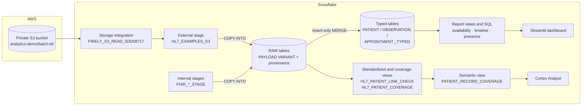
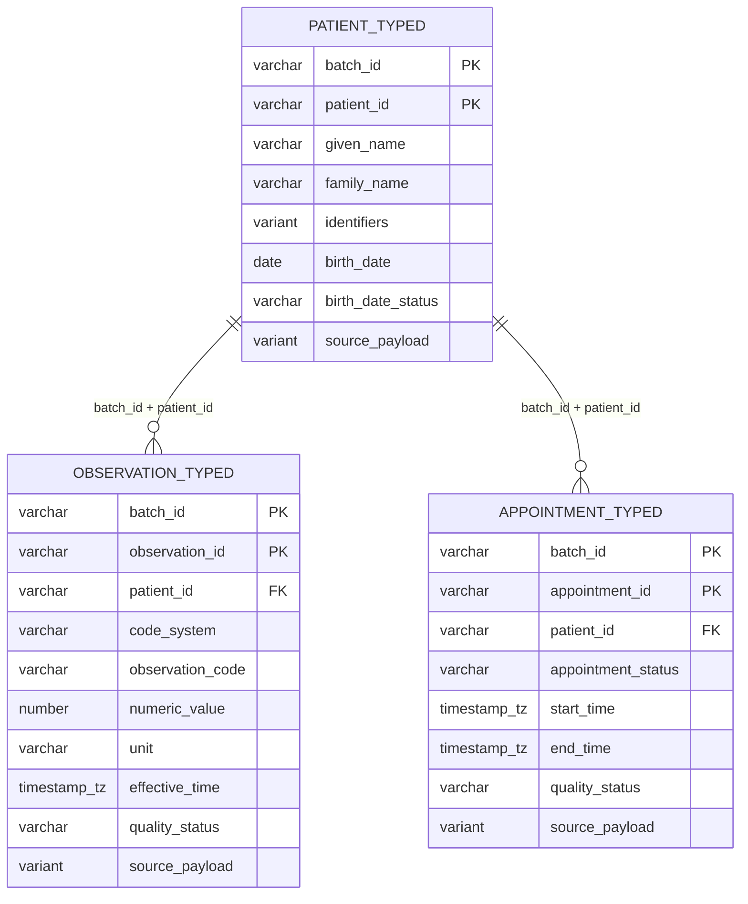

# Snowflake design

For data platform and Snowflake readers: how FHIR data lands, how it is modeled, how every load is proven correct and repeatable, and what a production build would change. All SQL referenced here is in the repository and was run against a real Snowflake account. Object names are as they exist in that account.

## At a glance

| Area | Design choice |
|---|---|
| Landing | NDJSON batches with a SHA-256 manifest. Loaded through a Snowflake internal stage (5–7 Oct) and an S3 external stage behind a storage integration (Phase 1, 8 Oct) |
| RAW | One row per FHIR resource per batch: `PAYLOAD VARIANT` plus resource type, resource ID, batch ID, source file, file row number and load time |
| Load safety | Explicit `FILES=` lists (manifests never loaded), `ON_ERROR = ABORT_STATEMENT`, `FORCE = FALSE`, fail-closed validation before merging |
| Idempotency | COPY load metadata skips already-loaded files; insert-only `MERGE` on batch + resource ID; reruns insert 0 rows |
| Typed layer | Patient, Observation and Appointment tables with timezone-aware timestamps, full source JSON and a `quality_status` of `valid` or `needs_review`. Rows are never dropped |
| Business rules | Visit requirements held as data (`APPOINTMENT_FC30_REQUIREMENTS`), evaluated in SQL views |
| Consumption | SQL reports, a Streamlit-in-Snowflake dashboard, and a Cortex Analyst semantic view |
| Compute | Dedicated X-Small warehouse `FIRELY_DEMO_WH`: auto-suspend 60 s, auto-resume, created suspended |
| Access to S3 | Storage integration trusting exactly one Snowflake IAM principal with an external ID, and a read-only role scoped to one prefix. No long-lived keys |

## Data flow



## Objects

Database `CHATGPT_LAB` (an existing lab database in the account).

| Schema | Object | Type | Purpose | Rows |
|---|---|---|---|---:|
| `FIRELY_RAW_5DD08717` | `FHIR_JSON` | File format | JSON for the first batch | – |
| | `FHIR_STAGE` → `FHIR_RESOURCE` | External stage → RAW table | Original S3 route for the first batch (blocked 4–7 Oct, see below) | 0 |
| | `FHIR_INTERNAL_STAGE` → `FHIR_RESOURCE_INTERNAL` | Internal stage → RAW table | First two-patient batch | 7 |
| | `PATIENT_TYPED`, `OBSERVATION_TYPED`, `APPOINTMENT_TYPED` | Tables | Typed layer for the first batch | 2 / 3 / 2 |
| | `FHIR_FC30_INTERNAL_STAGE` → `FHIR_RESOURCE_FC30` | Internal stage → RAW table | 30-patient failure-case batch | 147 |
| | `*_FC30_TYPED`, `APPOINTMENT_FC30_REQUIREMENTS`, `APPOINTMENT_FC30_REPORT` | Tables, config table, view | Typed layer, rules as data, availability report | – |
| | `FHIR_RESOURCE_HL7_BRIDGE`, `FHIR_RESOURCE_HL7_APPT_BRIDGE`, `FHIR_RESOURCE_HL7_PORTAL_REFRESH` | RAW tables (each `LIKE FHIR_RESOURCE_INTERNAL`) | Batches converted from HL7 messages | 3 / 4 / 5 |
| `FHIR_HL7_EXAMPLES` | `HL7_JSON`, `HL7_EXAMPLES_S3` → `RESOURCE_RAW` | File format, external S3 stage, RAW table | Phase 1: official FHIR R4 examples | 933 |
| `FHIR_STANDARDIZED` | `HL7_PATIENT_LINK_CHECK` | View | Resolves each clinical resource's patient reference | 641 |
| `FHIR_ANALYTICS` | `HL7_PATIENT_COVERAGE` | View | Linked-record counts per patient across nine categories | 265 |
| (workspace) | `PATIENT_RECORD_COVERAGE` | Semantic view | Cortex Analyst model over the coverage view | – |

Keeping each experiment's batch in its own RAW table, created `LIKE` the first one, keeps cohorts from mixing while preserving one column contract. Phase 1 instead uses a single RAW table keyed by `SOURCE_DATASET` + `BATCH_ID`, which is the shape a multi-source platform would standardize on.

## RAW layer

Every load uses the same pattern ([`internal-stage/01-copy.sql`](../analytics/sql/synthetic-20261004T225801Z-5dd08717/internal-stage/01-copy.sql), [`bridge-load.sql`](../analytics/snowflake/bridge-load.sql), [`fc30-load-and-report.sql`](../analytics/snowflake/fc30-load-and-report.sql)):

```sql
COPY INTO FHIR_RESOURCE_HL7_APPT_BRIDGE
  (payload, resource_type, resource_id, batch_id, source_filename, file_row_number, loaded_at)
FROM (SELECT t.$1, t.$1:resourceType::VARCHAR, t.$1:id::VARCHAR,
             'hl7-appointment-bridge-20261007T162957465413Z',
             METADATA$FILENAME, METADATA$FILE_ROW_NUMBER, METADATA$START_SCAN_TIME
      FROM @FHIR_HL7_APPT_BRIDGE_STAGE AS t)
FILES = ('Patient.ndjson', 'Observation.ndjson', 'Appointment.ndjson')
FILE_FORMAT = (TYPE = JSON) ON_ERROR = 'ABORT_STATEMENT' FORCE = FALSE;
```

The Phase 1 load ([`02_load_verify.sql`](../datasets/phase1-fhir-examples/02_load_verify.sql)) adds a fail-closed gate. COPY lands into a temporary `LOAD_WORK` table. An `EXECUTE IMMEDIATE` block then raises an exception unless the count is exactly 933, there are no duplicate or null IDs, and no payload conflicts with rows already in RAW. Only then does an insert-only `MERGE` publish the batch.

## Typed layer

[`typed-analytics.sql`](../analytics/snowflake/typed-analytics.sql) is the worksheet that built the typed layer:



- **Uniqueness first.** Source uniqueness on batch + type + ID is checked before any `MERGE`. Snowflake does not enforce primary keys, so the keys above are logical and enforced by the load pattern.
- **Strict parsing.**
  - Timestamps parse only when they carry `Z` or an offset, and are stored as `TIMESTAMP_TZ`.
  - Birth dates parse only as complete `YYYY-MM-DD` dates.
  - Patient references are accepted only in the relative form or from a known server base.
  - Anything else stays visible as `needs_review` or `invalid_or_unsupported`; nothing is filtered out.
- **Insert-only `MERGE`.** Reruns leave existing rows unchanged, because a batch is an immutable snapshot. Changed content under the same key is treated as an investigation, not a silent update.
- **Validation back to RAW.** A single validation query compares typed counts with distinct IDs, review rows, broken patient links and full-payload equality against RAW. Result: 2/3/2 rows, 0 review rows, 0 broken links, 0 payload mismatches ([CSV](../results/2026-10-06-typed-analytics/00-typed-validation.csv)).
- **Separate aggregation.** Reports aggregate observations and appointments separately before joining, so counts are never inflated by a fan-out join.

## Business rules in SQL

The information-availability rule from the application is reimplemented in SQL:
- Same patient, LOINC 2345-7, status final, amended or corrected, `quality_status = 'valid'`.
- `effective_time >= start - 7 days AND effective_time < start`.

Nine predicate tests pin the edge cases: inclusive start, exclusive appointment instant, status handling, timezone equivalence and missing time ([results](../results/2026-10-06-typed-analytics/04-rule-checks.csv)). For the 30-patient batch the rule configuration lives in a table (`APPOINTMENT_FC30_REQUIREMENTS`: code, window, unit, enabled). The report view therefore distinguishes `requirements_not_configured` from a real gap, and `not_applicable` for cancelled visits.

## Semantic layer and apps

- **Cortex Analyst** ([details](cortex-analyst.md)). The `PATIENT_RECORD_COVERAGE` semantic view models the coverage view, and its description states that zero linked records in a batch is not the clinical absence of a condition. The [metric catalogue](../datasets/phase1-fhir-examples/METRIC_CATALOGUE.md) defines grain, exclusions and 15 evaluation questions. [`Snowflake-Coverage-Demo.sql`](../analytics/snowflake/Snowflake-Coverage-Demo.sql) holds the read-only demo questions and the queries behind them.
- **Streamlit in Snowflake.** [`firely_streamlit_app.py`](../analytics/dashboard/firely_streamlit_app.py) runs on the warehouse runtime with Snowpark and no external credentials. It shows the HL7 bridge patient, labs and appointment, plus the failure-case analytics: status chart, records needing review, missing birth dates.
- **Cortex Code** ([details](cortex-code.md)). Used under a standing read-only instruction to explain the coverage view, check it for duplicates and impossible values, and trace the observation count from RAW to the report.

The coverage views and the semantic view were created in the Snowflake workspace. Their DDL and YAML are not exported to this repository yet; that is the first item on the roadmap below.

## How correctness is proven

| Check | Result | Evidence |
|---|---|---|
| RAW rows vs exported files: IDs, full payloads, file row numbers, source hashes | 7/7, 3/3, 4/4 and 5/5 match, 0 duplicates | [reproduce](../results/README.md#reproduce-the-reconciliation) |
| Repeat COPY of identical files | Every file `LOAD_SKIPPED`, 0 rows added | [portal refresh](../results/2026-10-07-portal-refresh/repeat-copy.csv), [HL7 bridge](../results/2026-10-07-hl7-bridge/repeat-load.csv) |
| Rerun of typed `MERGE`s | First load 2/3/2, every rerun inserted 0 | [query history](../results/2026-10-06-typed-analytics/05-merge-query-history.csv) |
| Typed layer vs RAW | 0 review rows, 0 broken links, 0 payload mismatches | [validation](../results/2026-10-06-typed-analytics/00-typed-validation.csv) |
| 30-patient expected vs actual | 30/30 outcomes match; 6/6 broken records flagged | `python analytics/compare_fc30_outcomes.py` |
| Cortex Code's independent lineage trace (Observation) | 531 in RAW, 503 resolved, 28 excluded (12 unresolved, 10 other format, 6 no reference); 0 duplicate IDs, 0 join fan-out. Matches the link check | [Cortex Code](cortex-code.md#what-it-did-here) |
| Phase 1 reference integrity vs an offline benchmark | Exact match: 609 of 641 clinical resources resolve to a Patient (95.0%); 15 unresolved, 10 other formats, 7 with no reference | [link check](../results/2026-10-08-fhir-r4-examples/patient-link-check.csv) |

## Security and cost

- **Storage integration, created the safe way.** The integration was first created **disabled**, which made `DESC INTEGRATION` return Snowflake's exact IAM principal and external ID. The AWS role was then created trusting only that principal with an `sts:ExternalId` condition, and with `GetBucketLocation`, prefix-limited `ListBucket`, `GetObject` and `GetObjectVersion` on one batch prefix ([policy](../analytics/sql/synthetic-20261004T225801Z-5dd08717/iam-read-policy.json), [trust](../analytics/sql/synthetic-20261004T225801Z-5dd08717/snowflake-trust.json)). A proposed broader temporary trust was rejected.
- **The 3167 error.** `LIST` failed from 4 to 7 Oct with `sts:AssumeRole` denied, even though the trust and external ID matched exactly. The cause was an AWS-managed resource control policy on free-plan "project" accounts that denies principals outside the organization. It was fixed at the organization level on 8 Oct, and Phase 1 then loaded directly from S3. While blocked, the internal stage kept the work moving without weakening any control.
- **Cost.** A dedicated X-Small warehouse with 60-second auto-suspend, kept separate from existing workloads, and no resizing.
- **Known gaps.** Objects were created with `ACCOUNTADMIN` because the existing lab role lacked `CREATE TABLE`. There is no resource monitor. There are no masking or tagging policies, which is acceptable only because the data is synthetic.

## Production roadmap

1. **Version everything.** Export the semantic view YAML and the coverage view DDL into this repository, and run the metric catalogue's evaluation questions as regression tests for Cortex Analyst.
2. **RBAC.**
   - Create functional roles (`FHIR_LOADER`, `FHIR_TRANSFORMER`, `FHIR_ANALYST`) under `SYSADMIN`, with future grants and schema-level ownership.
   - Grant `USAGE` on the integration to the loader role only.
   - Use `ACCOUNTADMIN` for account administration only.
3. **Automated ingestion.** Snowpipe auto-ingest from S3 event notifications per batch prefix, monitored through `COPY_HISTORY`, with the manifest check run as a task.
4. **Declarative transforms.** Dynamic tables, or streams and tasks, for the typed layer. Alternatively dbt models with uniqueness, relationship and accepted-value tests replacing the hand-written checks.
5. **Data quality.** Data metric functions (null, duplicate and freshness counts) on the typed tables, with alerts. `needs_review` rows routed to the integration team's worklist.
6. **PHI governance, for real data.** Classification and tags on identifiers, names and birth dates; masking policies by role; row access policies by facility; access-history auditing.
7. **Environments.** Development and test databases created as zero-copy clones, with schema changes deployed through CI (schemachange or Terraform). A resource monitor on every warehouse.
8. **Natural-language access for operations.** A second semantic view over `APPOINTMENT_FC30_REPORT`, so Cortex Analyst can answer appointment-readiness questions. An *Ask a question* box in the Streamlit dashboard through the Cortex Analyst REST API. Cortex Agents once several semantic views are in play.

---

<sub>**Reading order 8 of 12** · ← [HL7 → FHIR mapping](hl7-to-fhir-mapping.md) · [Cortex Analyst](cortex-analyst.md) → · [README](../README.md)</sub>
