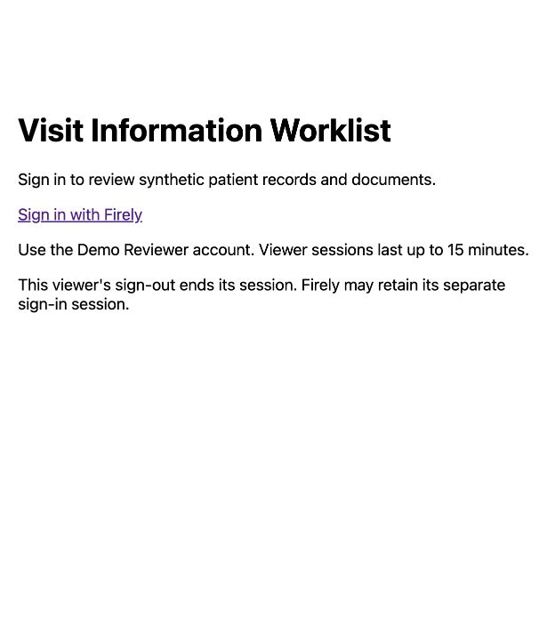
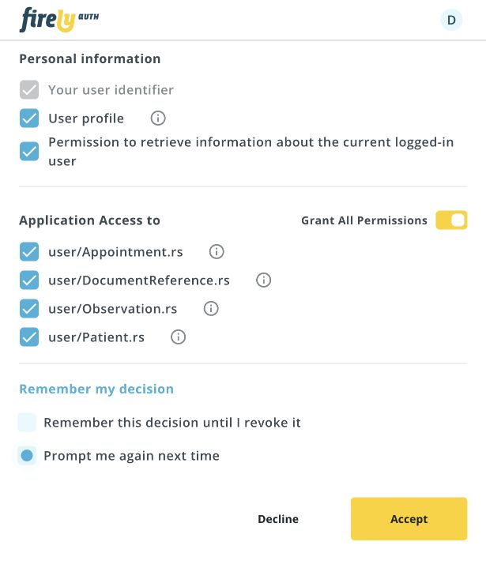
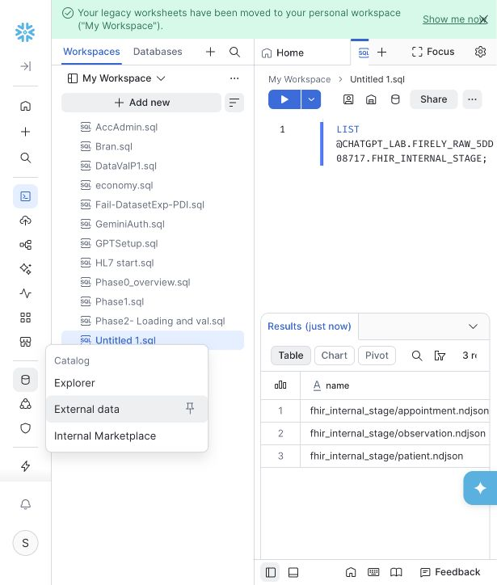
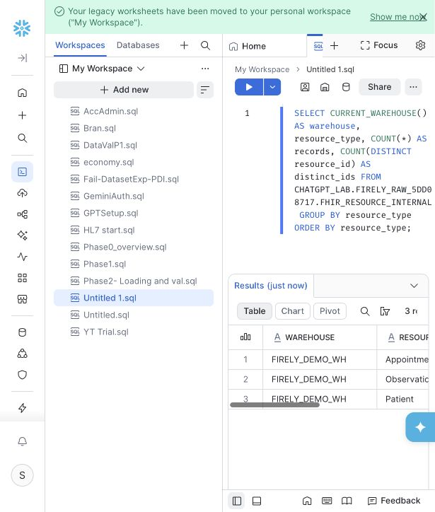

# Project tour: from an HL7 message to a governed answer

The whole project on one page, in the order it runs. Each step shows a screenshot or the key code, the number that proves the step worked, and a link to the page that covers it in depth. All data is synthetic or comes from the official HL7 FHIR R4 examples.

**Steps:** [1 Problem](#1-the-problem) · [2 Architecture](#2-architecture) · [3 HL7 → FHIR](#3-an-hl7-v2-message-becomes-a-fhir-resource) · [4 Firely, RDS and sign-in](#4-firely-server-amazon-rds-and-reviewer-sign-in) · [5 Assessment](#5-the-visit-is-assessed) · [6 Worklist and documents](#6-gaps-become-work-documents-are-gated) · [7 Export and S3](#7-export-and-landing-in-amazon-s3) · [8 Snowflake RAW](#8-snowflake-raw-reconciled-row-by-row) · [9 Typed layer](#9-typed-tables-and-the-rule-in-sql) · [10 30 patients and the dashboard](#10-thirty-patient-failure-cases-and-the-dashboard) · [11 The S3 fix](#11-the-s3-route-blocked-diagnosed-fixed) · [12 Cortex Analyst](#12-cortex-analyst-questions-in-plain-english) · [13 Cortex Code](#13-cortex-code-auditing-the-pipeline) · [14 CI](#14-every-claim-re-checked-in-ci)

## 1. The problem

In a JAMA study of 32 U.S. primary care clinics, clinicians reported important information missing in about **1 in 7 visits**, and lab results were the item missing most often. More than half of the missing information existed, just outside the clinic's own system ([references](../README.md#references)).

The platform answers one question for every booked visit: *is the required lab result on file, and if not, was it never done or is it stuck somewhere?* The first needs an order; the second needs a records request or an interface fix.

More: [business overview](business-overview.md)

## 2. Architecture


HL7 v2 feeds are converted to FHIR R4 on Firely Server. A secured Firely server feeds the rules engine, the worklist and a reviewer portal with Firely Auth sign-in. Batch exports load into Snowflake for reports, a Streamlit dashboard, Cortex Analyst and Cortex Code: through an internal stage while the S3 integration was blocked, and directly from Amazon S3 once it was fixed.

More: [architecture](architecture.md) · [decisions](decisions.md)

## 3. An HL7 v2 message becomes a FHIR resource

A lab system sends an ORU^R01 result ([`samples/lab-003.hl7`](../samples/lab-003.hl7), one segment per line here):

```
MSH|^~\&|DEMO|TRAINING|FIRELY|LOCAL|20261001100000-0400||ORU^R01^ORU_R01|SYN-LAB-003|T|2.5
PID|1||SYN002^^^DEMO^MR||Demo^Ravi||19850512|M
OBR|1||SYN-ORDER-003^DEMO|2345-7^Glucose serum or plasma^LN|||20261001100000-0400
OBX|1|NM|2345-7^Glucose serum or plasma^LN||102|mg/dL^mg/dL^UCUM|||||F
```

The converter accepts only this message shape, matches the patient by identifier (never by name) and derives the resource ID from the source keys ([`converters/convert_lab.py`](../converters/convert_lab.py)):

```python
def result_id(source_key):
    """Deterministic Observation ID, so replaying a message never creates a duplicate."""
    legacy = LEGACY_RESULT_IDS.get(tuple(source_key))
    if legacy:
        return legacy
    return "lab-" + str(uuid.uuid5(uuid.NAMESPACE_URL, json.dumps(source_key)))
```

The FHIR Observation it produces ([`samples/lab-003.fhir.json`](../samples/lab-003.fhir.json), abridged):

```json
{
  "resourceType": "Observation",
  "id": "lab-760b9ffe-19ca-5dbb-b2ef-8bb12d2cf2d4",
  "status": "final",
  "code": { "coding": [{ "system": "http://loinc.org", "code": "2345-7" }] },
  "subject": { "reference": "Patient/demo-patient-002" },
  "effectiveDateTime": "2026-10-01T10:00:00-04:00",
  "valueQuantity": { "value": 102.0, "unit": "mg/dL", "system": "http://unitsofmeasure.org" }
}
```

Admissions (ADT^A01) become Patients and bookings (SIU^S12) become Appointments the same way.

**Proof:** replaying a message gives the same ID, so nothing is duplicated. CI regenerates the lab converter's outputs and fails if one changes; the admission converter has unit tests and the SIU bridge a self-test.

More: [HL7 → FHIR mapping spec](hl7-to-fhir-mapping.md) · [walkthrough](walkthrough.md)

## 4. Firely Server, Amazon RDS and reviewer sign-in

Converted resources are stored in Firely Server. From 2 to 7 October the secured server was backed by **Amazon RDS for SQL Server** (us-east-2) with `Encrypt=True`, `TrustServerCertificate=False`, the RDS CA bundle in the container's trust store ([`infra/tls/Dockerfile`](../infra/tls/Dockerfile)) and database ingress limited to single-address rules.

Reviewers sign in through Firely Auth with OpenID Connect and PKCE. The portal is a public client with no secret, and the reviewer consents to read-only scopes:

| Sign-in page | Consent: read-only FHIR scopes |
|---|---|
|  |  |

| Firely Auth client: public, no secret | PKCE required, consent required |
|---|---|
|  |  |

**Proof:** 15 of 15 live checks in one real sign-in run ([repeatable verification](../archive/milestone-reports/2026-10-03-repeatable-verification.md)). Anonymous requests got 401; wrong-patient and unregistered documents, and logouts with a bad CSRF token or origin, got 403; and the old session cookie was rejected after logout. The rest were health, readiness and data checks.

More: [architecture: trust boundaries](architecture.md#trust-boundaries-and-controls) · [sanitized Firely Auth configuration](../infra/firely-auth/appsettings.instance.example.json)

## 5. The visit is assessed

The rule is configuration, not code ([`worklist/spec/v2/policy.json`](../worklist/spec/v2/policy.json), abridged):

```json
{
  "requirement_id": "glucose-result",
  "code": { "system": "http://loinc.org", "code": "2345-7" },
  "lookback_days": 7,
  "start_inclusive": true,
  "end_inclusive": false,
  "accepted_statuses": ["final", "amended", "corrected"],
  "require_numeric_value": true,
  "require_unit": true
}
```

Every visit gets one of four outcomes: `information_complete`, `information_gap`, `unable_to_assess` or `requirements_not_configured`. A gap is reported only after a complete, successful retrieval. In the rules engine a failed or partial read is `unable_to_assess`; the live portal shows an error instead of an outcome. The Snowflake report adds a fifth value, `not_applicable`, for cancelled visits.

The signed-in reviewer sees the result for the synthetic patient Ravi Demo: two qualifying glucose results, so the visit is complete.


More: [business overview: the four outcomes](business-overview.md#the-four-outcomes) · [worklist package](../worklist/README.md)

## 6. Gaps become work; documents are gated

A genuine gap becomes a work item for records staff, with a due time and the evidence behind it ([exported worklist history](../results/2026-10-02-worklist-assessment/worklist-history.json), abridged):

```json
{
  "appointment_id": "fixture-v2-a02",
  "issue_type": "missing_expected_record",
  "payload": {
    "owner_role": "records_staff",
    "due_at": "2026-10-05T12:00:00+00:00",
    "permitted_action": "Investigate availability and request records",
    "evidence": {
      "outcome": "information_gap",
      "matched_record_ids": [],
      "window_start": "2026-09-29T12:00:00+00:00",
      "window_end": "2026-10-06T12:00:00+00:00"
    }
  },
  "status": "resolved"
}
```

Data and interface faults go to the integration team instead. Resolving an item needs an actor, a reason and a fresh passing reassessment. Work items live in a SQLite worklist and the portal shows their history; a staff-facing screen for working them is not built yet.

Documents never leave as S3 links. The portal releases a synthetic PDF or image only after a registry check for the same patient, an authorized DocumentReference read that matches the registry, and a SHA-256 match after download; anything else returns 403 or 502. Since 7 October the portal has run in local mode, which defers document downloads.

More: [architecture: review flow](architecture.md#2-review-sign-in-assessment-and-documents) · [decisions ADR-005](decisions.md)

## 7. Export and landing in Amazon S3

On 4 October the portal exported the two demo patients through the reviewer's verified session. It read the cohort twice and went ahead only because both reads matched. The batch carries a manifest with counts, IDs and SHA-256 hashes ([manifest](../analytics/batches/synthetic-20261004T225801Z-5dd08717/manifest.json), abridged):

```json
{
  "batch_id": "synthetic-20261004T225801Z-5dd08717",
  "source": "http://localhost:8081",
  "counts": { "Patient": 2, "Observation": 3, "Appointment": 2 },
  "files": [
    { "filename": "patient.ndjson",     "sha256": "64c90a58…" },
    { "filename": "observation.ndjson", "sha256": "97b8b6f2…" },
    { "filename": "appointment.ndjson", "sha256": "9aa8185e…" }
  ],
  "source_comparison": { "second_authorized_read_identical": true },
  "snapshot_consistency": "Two matching reads; not a transactionally locked FHIR snapshot"
}
```

The batch was landed in a private S3 prefix with AES-256 encryption and no-overwrite conditional writes, and every object was downloaded again and hash-checked. Snowflake was to read it through an IAM role that trusts one Snowflake principal with an external ID, and can only list and read that batch's prefix ([policy](../analytics/sql/synthetic-20261004T225801Z-5dd08717/iam-read-policy.json), abridged):

```json
{
  "Effect": "Allow",
  "Action": ["s3:ListBucket"],
  "Resource": "arn:aws:s3:::<S3_BUCKET>",
  "Condition": { "StringLike": { "s3:prefix": ["analytics-demo/synthetic-20261004T225801Z-5dd08717/*"] } }
}
```

That route stayed blocked until 8 October ([step 11](#11-the-s3-route-blocked-diagnosed-fixed)). So this batch, and the three batches of 7 October, were loaded through Snowflake internal stages instead (step 8). Of those three, the portal-refresh batch was exported through the reviewer's session again, and the two HL7 bridge batches were read twice from the local source server.

More: [Snowflake design: security](snowflake-design.md#security-and-cost) · [S3 landing evidence](../results/2026-10-04-s3-landing/)

## 8. Snowflake RAW, reconciled row by row

`COPY INTO` loads named files only, keeps every payload as `VARIANT` with its source file and row, and aborts on any error ([`bridge-load.sql`](../analytics/snowflake/bridge-load.sql)):

```sql
COPY INTO FHIR_RESOURCE_HL7_APPT_BRIDGE
  (payload, resource_type, resource_id, batch_id, source_filename, file_row_number, loaded_at)
FROM (SELECT t.$1, t.$1:resourceType::VARCHAR, t.$1:id::VARCHAR,
             'hl7-appointment-bridge-20261007T162957465413Z',
             METADATA$FILENAME, METADATA$FILE_ROW_NUMBER, METADATA$START_SCAN_TIME
      FROM @FHIR_HL7_APPT_BRIDGE_STAGE AS t)
FILES = ('Patient.ndjson', 'Observation.ndjson', 'Appointment.ndjson')
FILE_FORMAT = (TYPE = JSON) ON_ERROR = 'ABORT_STATEMENT' FORCE = FALSE;
```

The first load, on 5 October, in Snowsight:

| Files in the internal stage | The count query over RAW ([results](../results/2026-10-05-internal-stage/internal-final-counts-20261005.csv)) |
|---|---|
|  |  |

The rows are downloaded back from Snowflake and checked against the export, ID by ID and payload by payload:

```
MATCH: Appointment/siu-appointment-17d6d563-4f77-5aac-b49b-2367195f7423
MATCH: Observation/demo-glucose-002
MATCH: Observation/lab-760b9ffe-19ca-5dbb-b2ef-8bb12d2cf2d4
MATCH: Patient/demo-patient-002
PASS: all 4 payloads and source rows match the Firely export.
PASS: available HL7 and converted source files match manifest hashes.
```

For the portal-refresh batch, running the identical `COPY` again added nothing ([result](../results/2026-10-07-portal-refresh/repeat-copy.csv)):

| File | Status | Rows loaded |
|---|---|---:|
| Patient.ndjson | `LOAD_SKIPPED` | 0 |
| Observation.ndjson | `LOAD_SKIPPED` | 0 |
| Appointment.ndjson | `LOAD_SKIPPED` | 0 |

**Proof:** the four exported batches' loads reconcile 7/7, 3/3, 4/4 and 5/5 with 0 duplicates, re-checked in CI on every push to main.

More: [Snowflake design: RAW layer](snowflake-design.md#raw-layer) · [reproduce the reconciliation](../results/README.md#reproduce-the-reconciliation)

## 9. Typed tables and the rule in SQL

For the first batch, insert-only `MERGE` builds typed Patient, Observation and Appointment tables ([`typed-analytics.sql`](../analytics/snowflake/typed-analytics.sql)); the 30-patient batch's typed tables are created once from RAW. Questionable rows are flagged for review, never dropped: with a `needs_review` status in the first batch's tables, and with a review reason in the 30-patient batch's. The application's rule is reimplemented in SQL ([`fc30-load-and-report.sql`](../analytics/snowflake/fc30-load-and-report.sql), abridged). The SQL version is stricter in one way, requiring the unit mg/dL, and it marks cancelled visits `not_applicable`:

```sql
COUNT_IF(
    o.observation_code = '2345-7'
    AND o.unit_code = r.accepted_unit_code
    AND o.value_numeric IS NOT NULL
    AND o.observation_status IN ('final', 'amended', 'corrected')
    AND o.effective_time >= DATEADD('day', -r.window_days, a.start_time)
    AND o.effective_time <  a.start_time
) AS qualifying_glucose_count
```

**Proof:** the Observation and Appointment `MERGE` reruns insert 0 rows; the typed layer has 0 review rows, 0 broken patient links and 0 payload mismatches against RAW; 9 of 9 window and status edge cases pass ([rule checks](../results/2026-10-06-typed-analytics/04-rule-checks.csv)).

More: [Snowflake design: typed layer](snowflake-design.md#typed-layer)

## 10. Thirty-patient failure cases and the dashboard

A generated batch of 30 synthetic patients, 87 observations and 30 appointments deliberately includes the hard cases: results out of the window or still preliminary, cancelled and unconfigured visits, invalid timestamps and references to unknown patients.

| Outcome | Appointments |
|---|---:|
| `information_complete` | 11 |
| `information_gap` | 13 |
| `not_applicable` (cancelled) | 2 |
| `requirements_not_configured` | 2 |
| `unable_to_assess` | 2 |

Two of the 13 gaps are results linked to an unknown patient. They are held for reference review rather than treated as final.

**Proof:** all 30 outcomes match the generator's expected outcomes, and all 6 deliberately broken records are flagged for review ([results](../results/2026-10-07-30-patient-batch/)).

The Streamlit-in-Snowflake dashboard shows the same picture to staff who ask the same questions every day. These captures are from the version deployed on 7 October; its labels and layout differ from the committed [`firely_streamlit_app.py`](../analytics/dashboard/firely_streamlit_app.py):

| Appointment information status | Appointment details |
|---|---|
|  |  |

More: [30-patient dataset](../datasets/fc30-failure-cases/README.md)

## 11. The S3 route: blocked, diagnosed, fixed

From 4 to 7 October, Snowflake's `LIST` of the S3 stage failed with error 3167, `sts:AssumeRole` denied, even though the trust principal and external ID matched exactly. The cause was an AWS-managed resource control policy on free-plan "project" accounts that denies principals outside the organization. A broader trust policy was rejected as a shortcut; the internal stage kept the work moving instead. The block was lifted at the organization level on 8 October.

The same day, a 933-record slice of the official FHIR R4 examples (11 resource types, 265 patients) loaded **directly from S3**, behind a fail-closed gate ([`02_load_verify.sql`](../datasets/phase1-fhir-examples/02_load_verify.sql), abridged):

```sql
IF (n <> 933 OR bad <> 0) THEN RAISE invalid_load; END IF;   -- count, duplicate and null IDs
...
IF (bad <> 0) THEN RAISE invalid_load; END IF;               -- payload conflicts with RAW
MERGE INTO RESOURCE_RAW t USING LOAD_WORK s ...              -- only then publish the batch
```

**Proof:** 609 of 641 clinical resources resolve to a patient, matching the offline benchmark exactly ([link check](../results/2026-10-08-fhir-r4-examples/patient-link-check.csv)).

More: [project history: the fix](project-history.md#8-s3--snowflake-fixed-and-phase-1-examples-8-oct) · [decisions ADR-008](decisions.md) · [external-stage diagnostics](../results/2026-10-04-snowflake-external-stage/)

## 12. Cortex Analyst: questions in plain English

A semantic view, `PATIENT_RECORD_COVERAGE`, records what the coverage data means, including its main caveat: zero linked records in a batch is not the clinical absence of a condition.


*Captured on 8 October while the model was being built, so the editor's footer shows a validation error in the draft. Cortex Analyst queried the deployed view, `CHATGPT_LAB.FHIR_SEMANTIC.PATIENT_RECORD_COVERAGE`, on 13 October.*

| Coverage by dataset and batch | Medication orders without an allergy record | A conclusion the data can't support |
|---|---|---|
|  |  |  |

**Proof:** 265 patients, 15 with observations, and the one patient with medication orders but no allergy record all match the offline benchmarks. Asked whether zero allergy records means no allergies, it says no and explains why.

More: [Cortex Analyst](cortex-analyst.md)

## 13. Cortex Code: auditing the pipeline

Under a standing read-only instruction, Cortex Code explained the coverage view, checked it for duplicates and impossible values, and traced the observation count from RAW to the report.

| Explain the coverage view | Check it can be trusted |
|---|---|
|  |  |

| Lineage trace: layers | Exclusions | Verdict |
|---|---|---|
|  |  |  |

**Proof:** 531 observations in RAW, 503 resolved, 28 excluded (12 unresolved, 10 in another reference format, 6 with no reference), 0 duplicates and 0 join fan-out, exactly matching the link check.

**And one lesson.**

| The session | What went wrong |
|---|---|
|  | Asked about patient ID `example`, a real patient with 71 observations and 4 allergy records, Cortex Code read "example" as *an example patient*. It picked patient `23` and answered correctly for the wrong patient. A non-technical user would never catch this. That is why the project's standing instruction says to keep requested patient IDs exactly, and to say so when an ID doesn't exist. |

More: [Cortex Code](cortex-code.md#4-a-lesson-for-patient-id-example-how-many-linked-observation-and-allergy-records-are-present)

## 14. Every claim re-checked in CI

[](https://github.com/tarunL2203/hl7-fhir-connected-care/actions/workflows/ci.yml)

`make check` runs on every push to main and every pull request, offline, with no servers or cloud accounts ([workflow](../.github/workflows/ci.yml)):

| Step | What it checks |
|---|---|
| Lint | Black and pyflakes |
| Tests | 51 unit and workflow tests: converters, export and reconciliation, sign-in, document gate, worklist |
| Reconcile | The four Snowflake loads against their exported batches, and the 30-patient outcomes |
| Reproduce | The lab converter's outputs and the 30-patient dataset regenerate byte for byte |

## What it doesn't do yet

The converters accept only the supported message shapes. Snowflake setup used `ACCOUNTADMIN`, and the semantic view's YAML isn't exported yet. See [scope and limitations](../README.md#scope-and-limitations) and the [production roadmap](snowflake-design.md#production-roadmap).

---

<sub>**Reading order 1 of 12** · [Business overview](business-overview.md) → · [README](../README.md)</sub>
