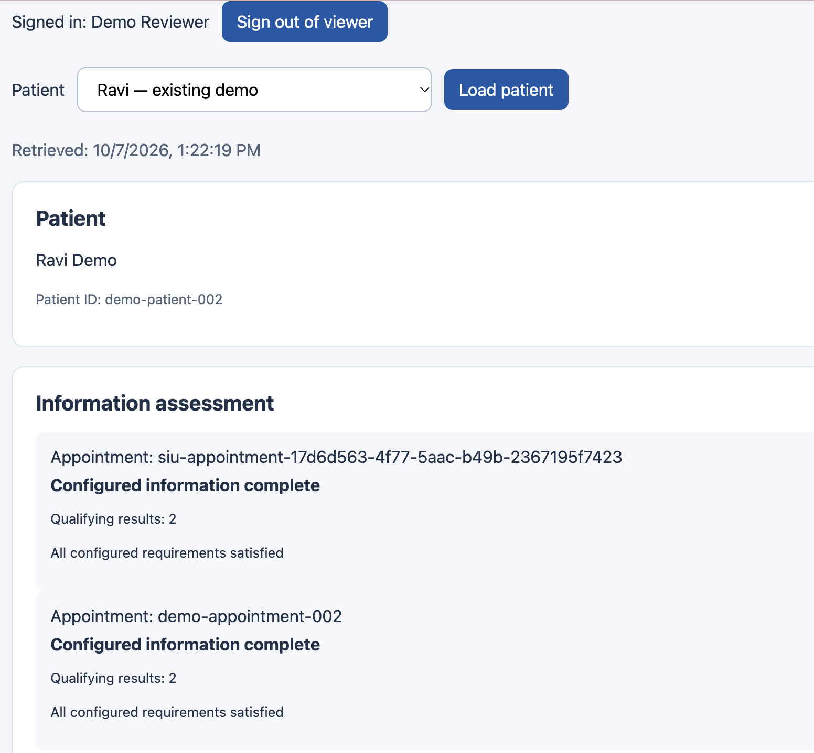

# One appointment, end to end

This walkthrough follows a single booked visit through the whole platform, using only artifacts committed in this repository. The patient is the synthetic "Ravi Demo" (`demo-patient-002`). The visit is a glucose review on **6 October 2026 at 13:00 UTC**, and the question is: *is a usable glucose result from the preceding week on file?*

## 1. Messages arrive (HL7 v2)

Two lab results and a booking arrive as HL7 v2 messages:

| Message | File | Content |
|---|---|---|
| ORU^R01 | [`lab-002.hl7`](../samples/lab-002.hl7) | Glucose **95 mg/dL**, final, measured 1 Oct 09:00 (UTC−4) |
| ORU^R01 | [`lab-003.hl7`](../samples/lab-003.hl7) | Glucose **102 mg/dL**, final, measured 1 Oct 10:00 (UTC−4), different order number |
| SIU^S12 | [`appointment-bridge-001.hl7`](../samples/appointment-bridge-001.hl7) | Booked 30-minute glucose review, 6 Oct 13:00–13:30 UTC (message sent 7 Oct) |

```
SCH|SYN-PLACER-BRIDGE-001^DEMO|SYN-APPT-BRIDGE-001^DEMO||||demo-glucose-review^Glucose review^L|...
PID|1||SYN002^^^DEMO^MR||Demo^Ravi||19850512|M
```

The demonstration ran on 7 October, after the visit's date. That doesn't change the answer: the rule's window is measured back from the appointment time, not from when the check runs.

## 2. They become FHIR resources

The converters validate each message and map it ([mapping spec](hl7-to-fhir-mapping.md)):

| FHIR resource | ID | Why this ID |
|---|---|---|
| Observation ([JSON](../samples/lab-002.fhir.json)) | `demo-glucose-002` | The original result keeps its ID |
| Observation ([JSON](../samples/lab-003.fhir.json)) | `lab-760b9ffe-19ca-5dbb-b2ef-8bb12d2cf2d4` | UUID5 of sender, facility, MRN, order and result number |
| Appointment ([JSON](../samples/appointment-bridge-001.fhir.json)) | `siu-appointment-17d6d563-4f77-5aac-b49b-2367195f7423` | UUID5 of sender, facility and filler appointment ID |

Each Observation is coded LOINC `2345-7` in UCUM `mg/dL`, with status `final` and a timezone-aware `effectiveDateTime`. The Appointment links to `Patient/demo-patient-002`. The bridge wrote it to Firely and read it back before going further. Replaying any of these messages produces the same IDs, so nothing is duplicated.

## 3. The visit is assessed

The rule in [`policy.json`](../worklist/spec/v2/policy.json) requires a final, amended or corrected glucose result with a unit, measured from **29 Sep 13:00 UTC** (inclusive) up to the appointment at **6 Oct 13:00 UTC** (exclusive). Both results (1 Oct 13:00 and 14:00 UTC) qualify, so the visit is **`information_complete`** with 2 qualifying results.

The signed-in reviewer sees exactly that. Every FHIR read used the reviewer's own token and followed every result page:



Had nothing qualified after a complete retrieval, the visit would have been `information_gap`, and a work item would have gone to records staff with a due time 24 hours before the visit. Had a read failed, it would have been `unable_to_assess` and routed to the integration team.

## 4. The patient's records are exported

The batch [`hl7-appointment-bridge-20261007T162957465413Z`](../analytics/batches/hl7-appointment-bridge-20261007T162957465413Z/) holds 1 Patient, 2 Observations and 1 Appointment as NDJSON. It was read from the local source server twice, and written only because both reads matched. Its [manifest](../analytics/batches/hl7-appointment-bridge-20261007T162957465413Z/manifest.json) records the SHA-256 of every file and of the HL7 and FHIR sources it came from.

## 5. Snowflake loads it, and the load is proven

[`bridge-load.sql`](../analytics/snowflake/bridge-load.sql) copies the three named files into the RAW table `FHIR_RESOURCE_HL7_APPT_BRIDGE`, keeping each payload as `VARIANT` with its file, row and batch. The rows downloaded back from Snowflake ([CSV](../results/2026-10-07-hl7-bridge/raw-download-appointment-bridge.csv)) are reconciled against the export:

```
$ python analytics/batches/hl7-portal-refresh-20261007T183326824850Z/reconcile_bridge.py \
    analytics/batches/hl7-appointment-bridge-20261007T162957465413Z \
    results/2026-10-07-hl7-bridge/raw-download-appointment-bridge.csv
MATCH: Appointment/siu-appointment-17d6d563-4f77-5aac-b49b-2367195f7423
MATCH: Observation/demo-glucose-002
MATCH: Observation/lab-760b9ffe-19ca-5dbb-b2ef-8bb12d2cf2d4
MATCH: Patient/demo-patient-002
PASS: all 4 payloads and source rows match the Firely export.
PASS: available HL7 and converted source files match manifest hashes.
```

This check runs in CI on every push to main.

## 6. The answer, in Snowflake

The same rule, evaluated in SQL over the loaded rows ([result](../results/2026-10-07-hl7-bridge/appointment-information-availability.csv)):

| Patient | Appointment | Status | Start (UTC) | Qualifying results | Information availability |
|---|---|---|---|---:|---|
| demo-patient-002 | siu-appointment-17d6d563… | booked | 2026-10-06 13:00 | 2 | **information_complete** |

The Streamlit dashboard applies the same rule to the 30-patient failure-case batch (this capture is from the version deployed on 7 October, whose labels differ from the committed app file):


## 7. A new result arrives

A third result, 110 mg/dL on 2 Oct ([`lab-portal-update-004.hl7`](../samples/lab-portal-update-004.hl7)), was converted and loaded:
- The portal's authenticated verification now finds **3 qualifying results**, still `information_complete`, and two reads agree ([verification](../analytics/batches/hl7-portal-refresh-20261007T183326824850Z/portal-verification.json)).
- The refreshed [batch](../analytics/batches/hl7-portal-refresh-20261007T183326824850Z/) holds 1 Patient, 3 Observations and 1 Appointment, and reconciles 5/5 against Snowflake.
- Repeating the identical `COPY` loaded nothing: every file returned [`LOAD_SKIPPED`](../results/2026-10-07-portal-refresh/repeat-copy.csv).

---

<sub>**Reading order 4 of 12** · ← [Background: HL7 v2 and FHIR](background-hl7-fhir.md) · [Architecture](architecture.md) → · [README](../README.md)</sub>
